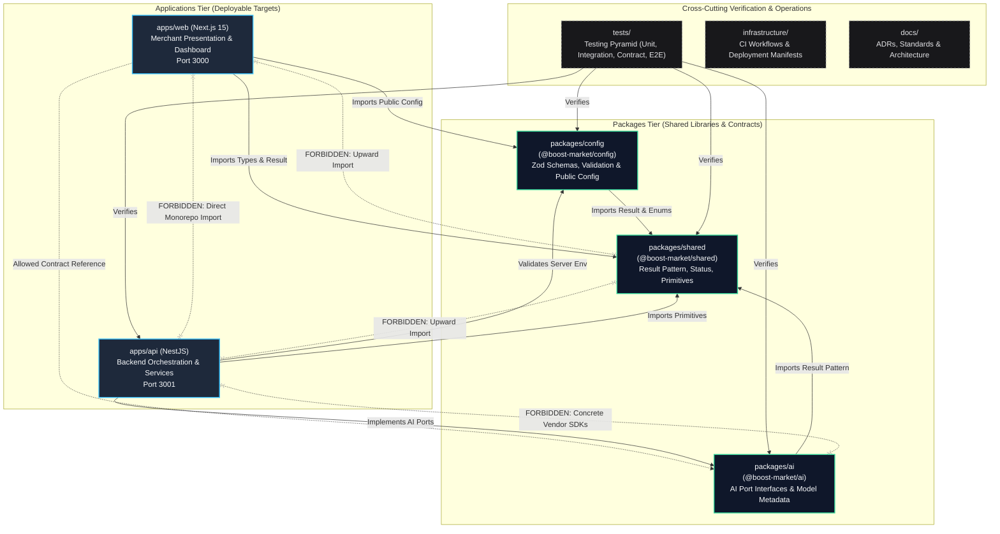

# Boost Market — Monorepo Application Boundaries & Architecture

**Document Version:** 1.0.0  
**Status:** Approved Architectural Baseline  
**Date:** 2026-10-29  
**Author:** Muhammad Kabeer Ahmed & Core Engineering Team  
**Governing Standard:** [DEVELOPMENT_STANDARDS.md](../standards/DEVELOPMENT_STANDARDS.md) & [ADR-001](../adr/ADR-001-monorepo-modular-clean-architecture.md)

---

## 1. Purpose and Architectural Principles

The purpose of this document is to establish the **macro-level application and package boundaries** for the Boost Market monorepo. It defines:
- The single, unambiguous responsibility of each application and package.
- What each unit **owns** and what it is **strictly forbidden from owning**.
- Allowed and prohibited communication paths across monorepo boundaries.
- Logical ownership mappings for future enterprise capabilities (e.g., authentication, payments, campaign orchestration, AI generation).
- Known architectural discrepancies and resolution paths.

### Core Architectural Principles

1. **The Inward Dependency Rule:**  
   Dependencies must point inward toward stability. Outer applications (`apps/web`, `apps/api`) depend on foundational packages (`packages/shared`, `packages/ai`, `packages/config`). Foundational packages must never import from outer applications or sibling packages unless explicitly permitted by architectural design.

2. **Single Responsibility at Package Scale:**  
   Every package and application must have exactly one reason to change:
   - Presentation changes modify `apps/web`.
   - Protocol/routing changes modify `apps/api`.
   - Core domain primitives modify `packages/shared`.
   - AI abstractions modify `packages/ai`.
   - Environment schema rules modify `packages/config`.

3. **Deterministic Authority over Probabilistic Intelligence:**  
   AI agents and models (`packages/ai`) only propose strategies, generate copy, or analyze images. Deterministic software (`apps/api` and core domain logic) validates, authorizes, audits, and executes all state transitions, financial transactions, and external ad spend.

4. **Zero Vendor & Framework Leakage:**  
   Foundational packages must remain pure TypeScript. They must never import Next.js, React, NestJS, Prisma, Stripe/Paystack SDKs, or cloud provider APIs.

5. **Loose Coupling, High Cohesion:**  
   Applications communicate exclusively via defined contracts, public DTOs, and strongly typed interfaces. Sibling applications (`apps/web` and `apps/api`) never import from each other directly.

---

## 2. Monorepo Boundary Overview

The monorepo is partitioned into three distinct tiers:
1. **Applications Tier (`apps/`):** Executable deployment targets (Next.js web presentation and NestJS API service).
2. **Packages Tier (`packages/`):** Reusable, shared domain primitives, configuration schemas, and AI port abstractions.
3. **Cross-Cutting Systems:** Documentation (`docs/`), Infrastructure manifests (`infrastructure/`), and Test suites (`tests/`).

### Boundary & Dependency Flow Diagram



---

## 3. Responsibility of Each Application and Package

### 3.1. Web Application (`apps/web` / `/app`)

* **Primary Responsibility:**  
  Delivering the user experience for Nigerian business owners and marketers. It renders the user interface, manages client-side UI states, collects merchant inputs, displays visual campaign analytics, and guides users through campaign creation wizards.
* **What It Owns:**
  - Next.js 15 pages, layouts, and route transitions.
  - React Presentation Components (buttons, modals, tables, KPI metric cards, wizard steps).
  - Client state management (wizard step state, UI theme toggles, form input state).
  - User interaction handlers (form submissions, button clicks, client-side validation).
  - The 3 mandatory UI states for every view: **Loading**, **Error**, and **Empty**.
  - Type-safe HTTP API client communicating with `apps/api` via standard fetch/REST over HTTP.
* **Allowed Dependencies:**
  - `packages/shared`: For `Result<T, E>`, domain primitives, and shared status types.
  - `packages/config`: For `PublicConfig` types and client-safe environment variables (`NEXT_PUBLIC_*`).
  - Third-party UI libraries: `lucide-react`, `motion/react`, `clsx`, `tailwind-merge`.
* **What It Must NOT Own:**
  - Business rules, state transition validations, or financial computations.
  - Direct database access (PostgreSQL, Redis, Prisma, Cloud SQL).
  - External advertising platform APIs (Meta Graph API, Google Ads API).
  - Direct third-party payment gateway charges (Paystack secret key operations).
  - Direct LLM calls using server-side secret API keys.
  - Background worker jobs or cron tasks.
* **Examples of Improper Placement:**
  - *Incorrect:* Calculating payment take-rate fees or ad platform markups inside a Next.js client component.
  - *Correct:* The client displays the fee returned by `apps/api/checkout/quote`.

---

### 3.2. API Application (`apps/api`)

* **Primary Responsibility:**  
  Serving as the backend application host and entry point. It is responsible for HTTP handling, request validation, dependency composition, authentication integration, and coordinating application operations.
* **What It Owns:**
  - Application runtime host, server bootstrap lifecycle (`main.ts`), and HTTP server configuration.
  - NestJS HTTP controllers, routing definitions, middleware, interceptors, and exception filters.
  - Request parsing, DTO transformation, and payload validation pipes.
  - Dependency composition root: wiring together application services, domain handlers, and infrastructure adapters via dependency injection.
  - Authentication and identity integration: JWT verification, session extraction, and tenant context propagation.
  - Coordinating application operations and orchestrating execution across services.
  - Health check endpoints, system telemetry, and audit logging.
* **Architectural Distinctions (Hosting vs. Capabilities vs. Adapters):**
  - **Backend Application Hosting (`apps/api`):** Provides the runtime process, server lifecycle, HTTP entry point, routing, configuration loading, middleware, and dependency wiring.
  - **Business Capability Ownership:** Business domain invariants, core entities, and use cases represent pure enterprise rules and workflows. While `apps/api` coordinates their execution at runtime, business rules themselves do not belong hardcoded directly inside NestJS controllers or tightly coupled to the framework host.
  - **Infrastructure Adapter Implementation:** Concrete technical implementations of external ports (database persistence, payment gateways, ad network clients, AI SDKs) that satisfy domain/application contracts. `apps/api` wires these adapters into application workflows during dependency composition.
* **Allowed Dependencies:**
  - `packages/shared`: For domain primitives, `Result<T, E>`, and enterprise error abstractions.
  - `packages/config`: For full validated server environment configuration (`ApiConfigService`).
  - `packages/ai`: For AI provider contracts, reasoning engine interfaces, and prompt contracts.
  - Backend infrastructure libraries: `@nestjs/*`, `rxjs`, database drivers.
* **What It Must NOT Own:**
  - React components, Next.js routing, or HTML rendering.
  - Client-side browser logic or client bundle compilation.
  - UI-specific formatting or CSS styles.
  - Direct coupling to `apps/web` or `/app` presentation source files.
* **Examples of Improper Placement:**
  - *Incorrect:* Embedding complex business domain rules or financial fee calculation formulas directly inside a NestJS controller action.
  - *Correct:* The controller delegates the request to an application use case, which executes pure business logic and returns a `Result` for the controller to serialize as an HTTP response.

---

### 3.3. Shared Package (`packages/shared`)

* **Primary Responsibility:**  
  Providing the foundational, framework-agnostic enterprise kernel. It contains universally applicable primitives, mathematical utilities, and common patterns that have identical meaning across the entire monorepo.
* **What It Owns:**
  - The functional `Result<T, E>` pattern (`Result.ok()`, `Result.fail()`).
  - Common system primitives: `Environment`, `SystemStatus`, timestamp utilities.
  - Common validation utilities and pure domain helpers (e.g., currency formatting helpers for Nigerian Naira `NGN`).
  - Universal identity types (`UUID`, `TenantId`, `UserId`).
* **Allowed Dependencies:**
  - **Zero external dependencies.** Standard TypeScript / Node built-in primitives only.
* **What It Must NOT Own:**
  - Framework code (React, Next.js, NestJS).
  - Database schemas, ORMs, or SQL queries.
  - Business use cases or application-specific workflows.
  - Concrete third-party vendor integrations (Meta, Google, Paystack, OpenAI).
  - Environment variable access (`process.env`).
* **Examples of Improper Placement:**
  - *Incorrect:* Reading `process.env.DATABASE_URL` inside `packages/shared`.
  - *Correct:* `packages/config` reads and validates `process.env`, utilizing `Result` from `packages/shared`.

---

### 3.4. AI Package (`packages/ai`)

* **Primary Responsibility:**  
  Defining vendor-neutral contracts, ports, metadata structures, and token/schema representations for artificial intelligence and generative operations.
* **What It Owns:**
  - Provider-agnostic interfaces (e.g., `IAIProviderContract`, `IReasoningEngine`, `ICreativeGenerator`).
  - Model capability metadata (`AIModelMetadata`, supported modalities, token limits).
  - Standard prompt input/output data transfer contracts.
  - Structured generative output schema definitions (e.g., ad headline variants, audience segment recommendations).
* **Allowed Dependencies:**
  - `packages/shared`: For `Result<T, E>` and basic primitives.
* **What It Must NOT Own:**
  - Concrete vendor SDK implementations (`@google/genai`, `openai`, `anthropic`).
  - Direct network requests to LLM provider endpoints.
  - Secret API keys (`GEMINI_API_KEY`, `OPENAI_API_KEY`).
  - Database persistence of generated creatives.
* **Examples of Improper Placement:**
  - *Incorrect:* Calling `new GoogleGenAI(process.env.GEMINI_API_KEY)` inside `packages/ai`.
  - *Correct:* `packages/ai` defines `ICreativeGenerator`. A concrete adapter inside `apps/api/src/ai/adapters/gemini.adapter.ts` implements it using `@google/genai` and injected credentials.

---

### 3.5. Configuration Package (`packages/config`)

* **Primary Responsibility:**  
  Centralizing, validating, and governing all environment variables, runtime configurations, and secrets across the monorepo.
* **What It Owns:**
  - Strongly typed configuration schemas (Zod).
  - Fail-fast environment variable validation logic (`validateEnv()`).
  - Sanitization logic: `extractPublicConfig()` ensuring zero backend secrets reach client bundles.
  - Port, URL, and runtime mode constraints.
* **Allowed Dependencies:**
  - `packages/shared`: For `Result<T, E>` and `Environment` types.
  - Validation libraries: `zod`.
* **What It Must NOT Own:**
  - Direct execution of business features or application logic.
  - Network requests or database connections.
  - UI components or HTTP routes.
* **Examples of Improper Placement:**
  - *Incorrect:* Initializing a database connection pool inside `packages/config`.
  - *Correct:* `packages/config` outputs a validated `DATABASE_URL` string, which the database module in `apps/api` consumes.

---

### 3.6. Cross-Cutting Systems

#### Documentation (`docs/`)
* **Responsibility:** Preserving architectural decisions, engineering standards, threat models, and operational runbooks.
* **Ownership:** Markdown documentation (`docs/adr/`, `docs/standards/`, `docs/architecture/`).
* **Boundary Rule:** Documentation describes the system; application code never imports or depends on documentation files.

#### Infrastructure (`infrastructure/`)
* **Responsibility:** Defining deployment manifests, continuous integration pipelines, container build specifications, and operational monitoring definitions.
* **Ownership:** CI workflows (`.github/workflows/ci.yml`), CI runbooks (`infrastructure/ci/README.md`), Dockerfiles, and future infrastructure-as-code manifests.
* **Boundary Rule:** Infrastructure configs orchestrate build and runtime environments; they do not contain enterprise business logic.

#### Tests (`tests/`)
* **Responsibility:** Validating the correctness, contract compliance, integration health, and performance of all monorepo code across the 4-tier testing pyramid.
* **Ownership:** Test runners, test data builders (`TestClock`, `SystemStatusBuilder`, `TestEnvironmentBuilder`), unit tests, integration tests, contract fixtures, and end-to-end scenarios.
* **Boundary Rule:** Test code imports from application code and packages to exercise them; production code **must never import from `tests/`**.

---

## 4. Explicit Ownership Rules & Matrix

| Monorepo Component | Primary Responsibility | Allowed Upstream Consumers | Allowed Downstream Dependencies | Strict Prohibitions |
| :--- | :--- | :--- | :--- | :--- |
| **`apps/web`** | User presentation, merchant dashboard, interactive wizards | End users via HTTP / Browser | `packages/shared`, `packages/config`, `packages/ai` (contracts only) | No direct DB access; no payment secrets; no direct Meta/Google API calls |
| **`apps/api`** | Backend application host, HTTP handling, dependency composition, operations coordination | `apps/web` via HTTP REST | `packages/shared`, `packages/config`, `packages/ai` | No React/JSX code; no UI state management; no browser APIs; no hardcoding business rules in controllers |
| **`packages/shared`** | Pure kernel primitives, `Result` pattern, universal types | `apps/web`, `apps/api`, `packages/config`, `packages/ai`, `tests` | None (pure TypeScript) | No external packages; no framework code; no I/O; no `process.env` |
| **`packages/ai`** | Vendor-agnostic AI ports, model interfaces, prompt schemas | `apps/api`, `apps/web` (for shared DTOs), `tests` | `packages/shared` | No concrete AI SDKs; no direct HTTP fetch to OpenAI/Gemini; no API keys |
| **`packages/config`** | Centralized Zod schema validation, environment governance | `apps/web` (public config only), `apps/api` (full config), `tests` | `packages/shared`, `zod` | No business logic; no database queries; no exposing secrets to web |
| **`infrastructure`** | CI/CD automation, deployment specifications | CI Runners, DevOps operators | None (executes tools) | No application domain code |
| **`tests`** | Automated verification pyramid (unit, integration, contract, e2e) | Test runners (`bun test`, `tsx --test`) | `packages/*`, `apps/*` | Production code must NEVER import from `tests` |

---

## 5. Allowed vs. Prohibited Cross-Package Responsibilities

### Allowed Interactions ✅
1. **`apps/web` $\rightarrow$ `apps/api` via HTTP:**  
   The web frontend invokes REST endpoints on the API backend using standardized JSON DTOs and Bearer tokens over HTTP.
2. **`apps/web` $\rightarrow$ `packages/config` (Public Only):**  
   The web frontend imports `PublicConfig` and client-safe helpers to read `NEXT_PUBLIC_` variables safely.
3. **`apps/api` $\rightarrow$ `packages/ai` Ports:**  
   The API application's use cases depend on interfaces declared in `packages/ai` (e.g., `ICreativeGenerator`). Concrete adapters in `apps/api` implement those interfaces.
4. **All Applications $\rightarrow$ `packages/shared`:**  
   Any package or application may import `Result<T, E>` and common status primitives.

### Prohibited Interactions ❌
1. **Sibling Monorepo Imports (`apps/web` $\longleftrightarrow$ `apps/api`):**  
   `apps/web` must NEVER import TypeScript files directly from `apps/api` or vice versa. They are independently compiled deployment units.
2. **Upward Dependency (`packages/shared` $\rightarrow$ `apps/*` or other packages):**  
   The shared kernel must never know about the web app, API app, AI contracts, or config schemas.
3. **Leaking Private Secrets into Web Bundles:**  
   `packages/config` must never expose `DATABASE_URL`, `JWT_SECRET`, or payment provider keys to `apps/web`.
4. **Concrete AI SDK in Contracts:**  
   `packages/ai` must never import `@google/genai` or `openai`. Adapters belong in `apps/api/src/ai/adapters`.
5. **Direct External Ad Network Calls from Frontend:**  
   `apps/web` must never call Meta Graph API or Google Ads API directly from client JavaScript. All ad network communications go through `apps/api` backend adapters.

---

## 6. Examples of Correct vs. Incorrect Architectural Placement

### Scenario A: Calculating Merchant Take-Rate Fees (e.g. 5% service markup)
* ❌ **Incorrect Placement:** Written inside a React component in `apps/web/src/components/CheckoutModal.tsx`.  
  *Why:* The client can be manipulated, creating financial fraud risks.
* ✅ **Correct Placement:** Defined in a pure domain calculation service, invoked by a use case in `apps/api`, with the resulting quote returned to `apps/web` over HTTP.

### Scenario B: Generating Ad Headlines via Gemini
* ❌ **Incorrect Placement:** `packages/ai` imports `@google/genai` and executes `generateContent()`.  
  *Why:* Binds the contract package to a specific vendor, preventing multi-model routing or offline mocking.
* ❌ **Incorrect Placement:** `apps/web` calls Gemini using a client-side API key.  
  *Why:* Exposes paid API keys to the browser.
* ✅ **Correct Placement:** `packages/ai` declares `ICreativeGenerator`. `apps/api` implements `GeminiCreativeAdapter` using `@google/genai` server-side, called via `GenerateAdCreativesUseCase`.

### Scenario C: Handling Paystack Webhook Notifications
* ❌ **Incorrect Placement:** Handled in a Next.js API route (`app/api/paystack/route.ts`) that writes directly to the database.  
  *Why:* Fractures business state management across two separate servers; bypasses NestJS audit logging and transactional pipelines.
* ✅ **Correct Placement:** Handled by a dedicated NestJS controller (`apps/api/src/payments/paystack-webhook.controller.ts`) that validates HMAC-SHA512 signatures and dispatches a domain event.

---

## 7. Future Capability Ownership Recommendations

As Boost Market advances through the roadmap, new enterprise capabilities will be introduced. The following architectural ownership rules govern where those capabilities must reside:

```text
┌──────────────────────────────────────────────────────────────────────────────────┐
│                             FUTURE CAPABILITY MATRIX                             │
├──────────────────────────┬─────────────────────────────┬─────────────────────────┤
│ Future Capability        │ Architectural Owner         │ Specific Responsibilities│
├──────────────────────────┼─────────────────────────────┼─────────────────────────┤
│ 1. Authentication &      │ apps/api (Authority)        │ Issues & verifies JWTs, │
│    Identity              │ apps/web (Presentation)    │ sessions, tenant guards; │
│                          │ packages/shared (Primitives)│ User & Tenant ID types. │
├──────────────────────────┼─────────────────────────────┼─────────────────────────┤
│ 2. Business Profiles &   │ apps/api (Domain & Storage) │ Merchant onboarding,    │
│    KYC/Verification      │ apps/web (UI Forms)         │ business metadata CRUD, │
│                          │                             │ CAC registration checks.│
├──────────────────────────┼─────────────────────────────┼─────────────────────────┤
│ 3. Ad Creative           │ packages/ai (Contracts)     │ Copy generation, image  │
│    Generation            │ apps/api (Adapter & Storage)│ generation, multi-format│
│                          │ apps/web (Review & Approval)│ preview components.     │
├──────────────────────────┼─────────────────────────────┼─────────────────────────┤
│ 4. Campaign Planning &   │ apps/api (Orchestration)    │ Campaign state machine, │
│    State Orchestration   │ apps/web (Wizard UI)        │ budget allocation logic,│
│                          │ packages/shared (States)    │ scheduling rules.       │
├──────────────────────────┼─────────────────────────────┼─────────────────────────┤
│ 5. Payments, Wallets &   │ apps/api (Financial Engine) │ Paystack integration,   │
│    Accounting            │ apps/web (Wallet UI)        │ ledger balance updates, │
│                          │                             │ invoice generation.     │
├──────────────────────────┼─────────────────────────────┼─────────────────────────┤
│ 6. Ad Network Adapters   │ apps/api (Adapter Layer)    │ Meta Marketing API,     │
│    (Meta, Google Ads)    │ packages/shared (Events)    │ Google Ads API, OAuth   │
│                          │                             │ token refresh, sync.    │
├──────────────────────────┼─────────────────────────────┼─────────────────────────┤
│ 7. Analytics, Ingestion  │ apps/api (Ingestion/Agg)    │ Campaign metrics sync,  │
│    & Optimization        │ apps/web (Dashboard Charts) │ CTR/ROAS calculations,  │
│                          │ packages/ai (Recommendations│ budget adjustment engine│
├──────────────────────────┼─────────────────────────────┼─────────────────────────┤
│ 8. Notifications &       │ apps/api (Dispatch Engine)  │ Termii SMS/WhatsApp,    │
│    Alerts                │ apps/web (Notification Bell)│ SendGrid email alerts,  │
│                          │                             │ user preference rules.  │
└──────────────────────────┴─────────────────────────────┴─────────────────────────┘
```

*Note: These allocations represent architectural ownership boundaries only. They do not constitute authorization to implement these capabilities ahead of their scheduled roadmap epics.*

---

## 8. Known Architectural Discrepancies & Resolution Paths

During the baseline inspection of Subtask 0.1.2.1, two specific architectural discrepancies were identified between the conceptual architecture and current workspace layout:

### Discrepancy 1: Web Application Co-location (`/app` vs `apps/web`)
* **Current Status:** `/app` is the currently active Next.js presentation host in this environment, serving the frontend on port 3000. `apps/web` exists as an established workspace stub (`apps/web/package.json`).
* **Future Migration Proposal:** Relocating or migrating `/app` into `apps/web` is a future proposal requiring its own explicit implementation plan and rigorous verification (including platform dev server routing, port bindings, and build configurations). In the current phase, no files are moved, and the active frontend structure remains unchanged.

### Discrepancy 2: Domain Package Naming Evolution (`ADR-001` vs Current Monorepo)
* **Observation:** ADR-001 initially referenced `packages/domain` and `packages/shared-kernel`. During Task 0.1.1, the monorepo was established with `packages/shared` (`@boost-market/shared`), `packages/ai` (`@boost-market/ai`), and `packages/config` (`@boost-market/config`).
* **Architectural Rationale:** `packages/shared` was established to anchor foundational primitives (`Result`, `SystemStatus`, `Environment`) before introducing enterprise domain entities.
* **Resolution Path:** In Task 0.1.3 (Domain Model Foundations), pure enterprise domain entities (e.g. Campaign, BusinessProfile, Money) will either be housed within a dedicated `@boost-market/domain` package or structured in a dedicated domain sub-namespace within the core architecture, strictly preserving the zero-dependency domain purity rule mandated by ADR-001.

---

## 9. Junior Engineer Defense Guide

*How to defend these boundaries in an architectural review or technical discussion:*

1. **Question:** *"Why can't `apps/web` call the Gemini or Meta API directly using server actions?"*  
   **Defense:** "Direct calls bypass our centralized audit logs, tenant authorization checks, rate-limiting guards, and financial state machines. If a client action fails midway, the database and ad platform get out of sync. `apps/api` must act as the single authoritative orchestrator."

2. **Question:** *"Why do we have a separate `packages/ai` instead of putting AI prompts directly in `apps/api`?"*  
   **Defense:** "`packages/ai` defines vendor-neutral ports and prompt schemas. If Meta or Google releases a superior model or if we want to run local models, we only implement a new adapter in `apps/api`. Our core business rules and prompt schemas remain untouched."

3. **Question:** *"Why should `packages/shared` remain dependency-light?"*  
   **Defense:** "`packages/shared` serves as the foundational kernel for the entire monorepo. Keeping it dependency-light minimizes coupling across consuming applications, prevents circular dependency cycles, eliminates unwanted transitive dependencies, and preserves maximum portability and testability across both server (Node.js/NestJS) and browser (Next.js) runtime environments."
