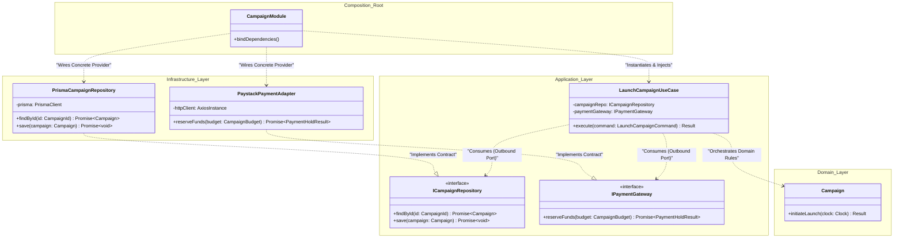
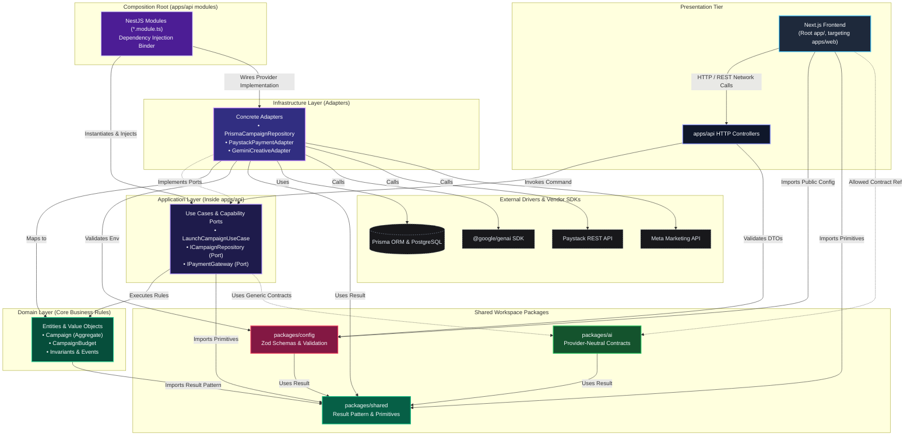

# Boost Market — Dependency-Direction Rules & Architectural Boundaries

**Document Version:** 1.1.0  
**Status:** Approved Architectural Baseline  
**Date:** 2026-10-30  
**Author:** Muhammad Kabeer Ahmed & Core Engineering Team  
**Governing Documents:**  
- [Application Boundaries (Macro-Architecture)](./application-boundaries.md)  
- [Internal Layered Architecture (Domain, Application, Infrastructure)](./layered-architecture.md)  
- [ADR-001: Monorepo and Modular Clean Architecture](../adr/ADR-001-monorepo-modular-clean-architecture.md)  
- [ADR-002: Engineering Standards and AI Governance](../adr/ADR-002-engineering-standards-and-ai-governance.md)  
- [ADR-003: Centralized Environment and Configuration Architecture](../adr/ADR-003-centralized-environment-and-configuration-architecture.md)  
- [ADR-004: Testing Architecture and Test Double Strategy](../adr/ADR-004-testing-architecture-and-test-double-strategy.md)  
- [ADR-005: Continuous Integration and Verification Pipeline](../adr/ADR-005-continuous-integration-and-verification-pipeline.md)  
- [Development Standards](../standards/DEVELOPMENT_STANDARDS.md)

---

## 1. Purpose

This document establishes the **explicit, unambiguous dependency-direction rules** governing the Boost Market monorepo. It dictates how deployable applications (the Next.js frontend, the NestJS backend `apps/api`), internal architectural layers (Domain, Application, Infrastructure, Presentation, Composition Root), shared workspace packages (`packages/shared`, `packages/ai`, `packages/config`), cross-cutting systems (`infrastructure/`, `tests/`), and external third-party SDKs may depend upon one another.

The monorepo is authored in strict TypeScript, managed via **Bun workspaces** (`bun.lock`), and executed on **Node.js 22** (`.nvmrc`). 

Currently, the active Next.js frontend application resides at the repository root (`app/`, `next.config.ts`, `postcss.config.mjs`, `lib/`, `hooks/`) with `apps/web` serving as a workspace placeholder manifest pending future migration. The orchestration API is housed in `apps/api`.

As Boost Market scales across complex capabilities—including merchant identity, multi-channel ad creation, AI creative generation, automated budget scheduling, Paystack/Flutterwave payments, and Meta/Google distribution—strict dependency discipline ensures:
1. Enterprise business logic remains immune to framework churn, database migrations, and cloud provider updates.
2. High-level use cases direct abstractions rather than coupling to volatile vendor SDKs.
3. Infrastructure adapters conform strictly to contracts defined by consuming capabilities.
4. Applications and packages maintain high cohesion without forming cyclic dependencies or turning shared libraries into dumping grounds.

---

## 2. Architectural Principles

The dependency architecture of Boost Market is governed by seven non-negotiable principles:

1. **The Inward Dependency Rule:**  
   Dependencies flow strictly inward toward business stability:
   $$\text{Presentation / Infrastructure} \longrightarrow \text{Application} \longrightarrow \text{Domain}$$
   Core business policies must never depend on outer layers, technical mechanisms, presentation devices, or third-party libraries.
2. **Abstraction over Concretion:**  
   High-level application modules must not depend on low-level technical adapters; both depend on abstractions. Detail depends on policy, never policy on detail.
3. **Consumer-Driven Contracts (Port Ownership):**  
   Outbound port interfaces are declared and owned by the consuming application capability or module, not by the implementing infrastructure adapter or a generic shared library.
4. **Zero Sibling Coupling:**  
   Deployable applications (the web frontend and `apps/api`) and bounded functional capabilities must never import each other's internal implementation files. Communication occurs exclusively across defined public protocols (HTTP REST/JSON, event streams, or public DTO contracts).
5. **Strict Package Purity:**  
   Foundational workspace packages (`packages/shared`, `packages/ai`, `packages/config`) must never import from outer applications or concrete vendor implementations.
6. **Deterministic Authority over Probabilistic Intelligence:**  
   AI models, probabilistic inference engines, and external ad network algorithms are strictly advisory. Deterministic domain code validates rules, authorizes actions, audits events, and governs state transitions.
7. **Acyclic Dependency Graph (Strict DAG):**  
   The dependency graph across layers, packages, and internal modules must form a Directed Acyclic Graph (DAG). Any direct or indirect cyclic dependency is a fatal architectural violation.

---

## 3. The Dependency Inversion Principle (DIP) in Boost Market

### 3.1. Theoretical Foundation & The Problem of Direct Coupling

In traditional procedural or layered architectures, high-level business use cases import low-level infrastructure modules directly:

```text
[Traditional Flawed Coupling]
LaunchCampaignUseCase  ─── imports directly ───>  PrismaClient / PostgreSQL
```

This direct coupling introduces severe vulnerabilities:
- **Framework & Database Lock-In:** Any change to Prisma's schema generation, query API, or database connection driver forces modifications inside the business use case.
- **Flaky & Slow Testing:** The use case cannot be unit-tested without provisioning a live PostgreSQL instance, installing migrations, and cleaning database state between tests.
- **Leaky Database Concerns:** ORM-specific types, nullability quirks, and persistence errors bleed into enterprise business workflows.

### 3.2. How DIP Resolves This in Boost Market

The Dependency Inversion Principle (DIP) states:
1. *High-level modules should not depend on low-level modules. Both should depend on abstractions.*
2. *Abstractions should not depend on details. Details should depend on abstractions.*

In Boost Market, when `LaunchCampaignUseCase` needs to load and persist a campaign aggregate, it does not import Prisma. Instead, the use case defines the exact persistence capabilities it requires through an abstract interface: `ICampaignRepository`.

```text
[Boost Market Clean Architecture with DIP]
Application Layer:
  LaunchCampaignUseCase  ─── depends on ───>  ICampaignRepository (Port Interface)
                                                      ▲
                                                      │ implements
Infrastructure Layer:                                 │
  PrismaCampaignRepository  ──────────────────────────┘
```

### 3.3. Core Architectural Reasons for DIP Structure

1. **Why the Interface Belongs with the Consuming Capability:**  
   The `ICampaignRepository` interface is declared within the campaign application capability because the application capability dictates *what* business data it requires to fulfill its use case. The application is the client; the repository is a service provider. Letting infrastructure declare the interface would allow database mechanics to dictate application design.
2. **Why Infrastructure Depends on the Contract:**  
   The concrete `PrismaCampaignRepository` class resides in the Infrastructure Layer and implements `ICampaignRepository`. The arrow of source code dependency points inward toward the application contract, inverting the runtime control flow.
3. **Why the Application Does Not Depend on the Database Implementation:**  
   Because `LaunchCampaignUseCase` imports only the TypeScript interface `ICampaignRepository`, the database implementation can be swapped (e.g., from Prisma to Drizzle, or to an in-memory double) without modifying a single line of business orchestration code.
4. **How Dependency Injection Connects Implementation at Runtime:**  
   At compile time, the Application Layer has zero reference to Prisma. At runtime, the **Composition Root** (the NestJS module container in `apps/api`) binds `PrismaCampaignRepository` to the `ICampaignRepository` injection token and injects it into `LaunchCampaignUseCase`.

### 3.4. Mermaid Diagram: Dependency Inversion in Action



---

## 4. Layer-Level Dependency Rules

The platform organizes code into five conceptual architectural tiers: Domain, Application, Infrastructure, Presentation, and the Composition Root. The table below governs source-code dependencies across these tiers.

```text
┌────────────────────────────────────────────────────────────────────────┐
│                        LAYER DEPENDENCY SUMMARY                        │
├─────────────────┬──────────────────────────┬───────────────────────────┤
│ Layer           │ Permitted Dependencies   │ Strictly Prohibited       │
├─────────────────┼──────────────────────────┼───────────────────────────┤
│ Domain          │ None (Pure TypeScript)   │ App, Infra, Presentation, │
│                 │ packages/shared (types)  │ Frameworks, Databases, SDKs│
├─────────────────┼──────────────────────────┼───────────────────────────┤
│ Application     │ Domain                   │ Concrete Infrastructure,  │
│ (Use Cases)     │ Capability Outbound Ports│ Vendor SDKs, HTTP Request/│
│                 │ packages/shared, ai      │ Response Framework Objects│
├─────────────────┼──────────────────────────┼───────────────────────────┤
│ Infrastructure  │ Application Contracts    │ Presentation Controllers, │
│ (Adapters)      │ Domain Entities/Types    │ Bypassing Domain Invariants│
│                 │ External SDKs, DB Drivers│ Direct Client Mutation    │
├─────────────────┼──────────────────────────┼───────────────────────────┤
│ Presentation    │ Application Use Cases    │ Direct Database Access,   │
│ (Controllers/UI)│ Public Inbound DTOs      │ Bypassing Use Cases,      │
│                 │ packages/shared, config  │ Direct Domain Rule Rewrite│
├─────────────────┼──────────────────────────┼───────────────────────────┤
│ Composition Root│ Application Use Cases    │ Housing Business Logic,   │
│ (*.module.ts)   │ Application Port Tokens  │ Bypassing Contracts,      │
│                 │ Concrete Infra Adapters  │ Re-exporting Infra to App │
└─────────────────┴──────────────────────────┴───────────────────────────┘
```

### 4.1. Domain Layer Rules
* **Permitted Dependencies:**  
  - Pure TypeScript language primitives.
  - Domain primitive types and functional error wrappers from `packages/shared` (e.g., `Result<T, E>`).
* **Strictly Prohibited Dependencies:**  
  - NestJS decorators or modules (`@Injectable()`, `@Controller()`, `@nestjs/*`).
  - Next.js or React runtime APIs (`'use client'`, `useEffect`, `next/*`).
  - Prisma client or schema objects (`@prisma/client`, Prisma DMMF).
  - Relational database drivers or ORMs (`pg`, `typeorm`, `drizzle`).
  - In-memory data store clients (`ioredis`, Redis SDK).
  - Third-party AI SDKs (`@google/genai`, `openai`, `anthropic`).
  - Advertising platform SDKs (`facebook-nodejs-business-sdk`, Google Ads API).
  - Payment provider SDKs (`paystack`, `stripe`, `flutterwave-node-v3`).
  - Operating system I/O, network sockets, or global environment access (`process.env`).
  - Application Layer use cases or Infrastructure Layer adapters.
* **Justified Exceptions:** None. The Domain Layer is unconditionally pure.

### 4.2. Application Layer Rules (Use Cases & Application Services)
* **Permitted Dependencies:**  
  - The Domain Layer (entities, value objects, domain events, domain errors).
  - Outbound port interfaces defined by the capability (e.g., `ICampaignRepository`, `IPaymentGateway`, `IJobQueue`).
  - Common domain primitives and functional error types from `packages/shared`.
  - Reusable, provider-neutral capability contracts from `packages/ai` (e.g., `IAIProviderContract`).
* **Strictly Prohibited Dependencies:**  
  - Concrete infrastructure implementations (e.g., `PrismaCampaignRepository`, `PaystackPaymentAdapter`).
  - Direct third-party vendor SDKs (`@google/genai`, `openai`, `facebook-nodejs-business-sdk`).
  - Web framework HTTP request/response objects (Express `Request`/`Response`, NestJS `@Req()`, `@Res()`).
  - Presentation components or Next.js client modules.
* **Justified Exceptions:** None. Application logic is framework-agnostic and relies strictly on ports.

### 4.3. Infrastructure Layer Rules (Adapters)
* **Permitted Dependencies:**  
  - Application Layer outbound port contracts and interfaces (which infrastructure implements).
  - Domain Layer entities, value objects, and types (for mapping between database records and domain aggregates).
  - Third-party vendor SDKs (`@google/genai`, Paystack REST clients, Meta Graph API SDKs).
  - Persistence drivers, ORMs, and caches (`@prisma/client`, `pg`, `ioredis`, `bullmq`).
  - Centralized configuration schemas and services from `packages/config`.
  - NestJS dependency injection decorators (`@Injectable()`).
* **Strictly Prohibited Dependencies:**  
  - Presentation Layer controllers, views, or UI components.
  - Redefining, altering, or bypassing business invariants established in the Domain Layer.
  - Invoking database queries that update aggregate state without loading the aggregate and passing through domain methods.
* **Justified Exceptions:** None.

### 4.4. Presentation Layer Rules (Controllers & Frontend UI)
* **Permitted Dependencies:**  
  - Application Layer use cases and inbound command/query ports.
  - Inbound and outbound DTO contracts.
  - Common domain primitives (`Result<T, E>`, `SystemStatus`) from `packages/shared`.
  - Public browser-safe configuration from `packages/config` (for client dashboards).
  - Web framework routing and serialization constructs (`@Controller()`, `@Post()`, `NextResponse`).
* **Strictly Prohibited Dependencies:**  
  - Direct imports of Infrastructure repositories, database clients (Prisma), or cache clients.
  - Direct instantiation or execution of third-party vendor SDKs (payment, ad networks, AI SDKs).
  - Bypassing Application use cases to perform ad-hoc domain mutations.
  - Direct network or filesystem calls from the web frontend into private backend infrastructure.
* **Justified Exceptions:** Testing fixtures and composition root setup files during integration test runs.

### 4.5. Composition Root Rules (Assembly & Wiring Modules)
* **Role & Permitted Dependencies:**  
  - The Composition Root comprises the module bootstrap files in `apps/api` (`app.module.ts`, `main.ts`, and feature modules like `campaign.module.ts`).
  - It is **explicitly permitted** to import Application use cases (`LaunchCampaignUseCase`), Application port tokens (`ICampaignRepository`), and concrete Infrastructure adapters (`PrismaCampaignRepository`, `PaystackPaymentAdapter`) solely to wire them together via NestJS dependency injection.
* **Strict Scope Restriction:**  
  - **This permission is strictly restricted to composition-root modules (`*.module.ts`, `main.ts`).**
  - Ordinary application use cases (`*.usecase.ts`), services, and command handlers must **never** import infrastructure.
  - The Domain Layer must **never** import infrastructure.
  - Infrastructure adapters must implement application-owned contracts.
  - Composition-root modules must never contain business rules or re-export concrete infrastructure classes back into application use cases.

---

## 5. Package-Level Dependency Rules (Workspace Dependency Matrix)

The Boost Market monorepo contains distinct workspace components. The matrix below defines the permitted (`ALLOW`), forbidden (`DENY`), and conditional relationships across all packages and internal sub-modules.

```text
┌────────────────────────────────────────────────────────────────────────────────────────┐
│                          WORKSPACE PACKAGE DEPENDENCY MATRIX                           │
├─────────────────┬──────────┬──────────┬──────────┬──────────┬──────────┬────────┬──────┤
│ Importer ↓      │ apps/web*│ apps/api │ pkg/shrd │  pkg/ai  │ pkg/cfg  │ infra/ │tests/│
├─────────────────┼──────────┼──────────┼──────────┼──────────┼──────────┼────────┼──────┤
│ apps/web (Front)│    —     │   DENY   │  ALLOW   │ COND (1) │  ALLOW   │  DENY  │ DENY │
├─────────────────┼──────────┼──────────┼──────────┼──────────┼──────────┼────────┼──────┤
│ apps/api (UseCs)│   DENY   │    —     │  ALLOW   │  ALLOW   │  ALLOW   │  DENY  │ DENY │
├─────────────────┼──────────┼──────────┼──────────┼──────────┼──────────┼────────┼──────┤
│ apps/api (Root) │   DENY   │    —     │  ALLOW   │  ALLOW   │  ALLOW   │COND (2)│ DENY │
├─────────────────┼──────────┼──────────┼──────────┼──────────┼──────────┼────────┼──────┤
│ packages/shared │   DENY   │   DENY   │    —     │   DENY   │   DENY   │  DENY  │ DENY │
├─────────────────┼──────────┼──────────┼──────────┼──────────┼──────────┼────────┼──────┤
│ packages/ai     │   DENY   │   DENY   │  ALLOW   │    —     │   DENY   │  DENY  │ DENY │
├─────────────────┼──────────┼──────────┼──────────┼──────────┼──────────┼────────┼──────┤
│ packages/config │   DENY   │   DENY   │  ALLOW   │   DENY   │    —     │  DENY  │ DENY │
├─────────────────┼──────────┼──────────┼──────────┼──────────┼──────────┼────────┼──────┤
│ infrastructure/ │   DENY   │ COND (3) │  ALLOW   │  ALLOW   │  ALLOW   │   —    │ DENY │
├─────────────────┼──────────┼──────────┼──────────┼──────────┼──────────┼────────┼──────┤
│ tests/          │  ALLOW   │  ALLOW   │  ALLOW   │  ALLOW   │  ALLOW   │ ALLOW  │  —   │
└─────────────────┴──────────┴──────────┴──────────┴──────────┴──────────┴────────┴──────┘
```

*\*Note on `apps/web`: Reflects the frontend presentation tier (currently executing from the repository root `app/`, `next.config.ts`, `lib/`, `hooks/`, with `apps/web` serving as an empty workspace placeholder pending future migration).*

### Condition Clarifications

* **COND (1):** `apps/web` (and the root frontend application) may reference provider-neutral AI contract metadata types (`AIModelMetadata` from `@boost-market/ai`) solely to render model choices in merchant UI wizards. It must never instantiate or invoke AI execution.
* **COND (2):** In `apps/api (Composition Root Modules)` (`*.module.ts`, `main.ts`), concrete infrastructure adapters (e.g., `PrismaCampaignRepository`, `PaystackPaymentAdapter`) may be imported **exclusively** to register providers and bind them to application-owned injection tokens. Ordinary use cases (`apps/api (UseCs)`) are strictly prohibited from importing infrastructure (`DENY`).
* **COND (3):** `infrastructure/` maintains read-only consumption of deployment manifests, dockerfiles, and CI configurations.

---

### Detailed Component Analysis

#### 1. `apps/web` (Next.js Frontend Presentation Tier)
* **Implementation vs. Target Reality:**
  - **Current Implementation:** The active Next.js frontend application currently executes from the repository root directory ([`app/`](file:///c:/Users/DELL/Desktop/boostmarket/app), [`next.config.ts`](file:///c:/Users/DELL/Desktop/boostmarket/next.config.ts), [`postcss.config.mjs`](file:///c:/Users/DELL/Desktop/boostmarket/postcss.config.mjs), [`lib/`](file:///c:/Users/DELL/Desktop/boostmarket/lib), [`hooks/`](file:///c:/Users/DELL/Desktop/boostmarket/hooks)). The [`apps/web/`](file:///c:/Users/DELL/Desktop/boostmarket/apps/web) directory currently contains only a package manifest ([`apps/web/package.json`](file:///c:/Users/DELL/Desktop/boostmarket/apps/web/package.json)).
  - **Intended Future Structure:** In the planned target architecture, all root frontend assets will be migrated into `apps/web/`, establishing `apps/web` as a fully self-contained Next.js application workspace.
  - **Unperformed Migration Work:** This directory relocation has explicitly **not yet happened** and is deferred to a future monorepo restructuring task. For the purposes of architectural enforcement, all code operating as the frontend (at the repository root or inside `apps/web`) is governed by these frontend presentation rules.
* **Allowed Dependencies:**  
  - `@boost-market/shared`: For `Result<T, E>`, status types, and UI formatting primitives.
  - `@boost-market/config`: For `PublicClientConfig` (browser-safe public variables prefixed with `NEXT_PUBLIC_`).
  - `@boost-market/ai`: **Conditional (1)** — Allowed for contract references and type metadata (e.g., `AIModelMetadata`) needed to render model options in merchant wizards.
* **Forbidden Dependencies:**  
  - `apps/api`: Strictly forbidden. Web and API must never import each other's code. Communication is strictly HTTP/REST over network ports.
  - `infrastructure/` & Concrete Adapters: Strictly forbidden. Web UI cannot access server-side infrastructure files.
  - `tests/`: Strictly forbidden. Production code must never import test fixtures.
* **Reasoning:** Prevents leaking server secrets, database credentials, or backend models into the client JavaScript bundle.

#### 2. `apps/api` (NestJS Backend Orchestrator)
* **Separation of Concerns within `apps/api`:**
  - **Application Use Cases (`apps/api (UseCs)`):** Orchestrate business workflows. They import Domain models and consume capability-owned outbound ports (`ICampaignRepository`). They are **strictly forbidden** from importing concrete infrastructure adapters (`PrismaCampaignRepository`, `PaystackPaymentAdapter`).
  - **Composition Root Modules (`apps/api (Root)`):** NestJS modules (`*.module.ts`, `app.module.ts`, `main.ts`). They are **permitted** to import concrete infrastructure adapters solely to bind them to application injection tokens via NestJS dependency injection.
* **Allowed Dependencies:**  
  - `@boost-market/shared`: For core domain primitives, functional error types, and system statuses.
  - `@boost-market/config`: For `ServerConfig`, environment validation schemas, and secret access.
  - `@boost-market/ai`: For provider-neutral AI port interfaces.
  - `infrastructure/`: Deployment manifests and CI configurations during deployment tasks.
* **Forbidden Dependencies:**  
  - `apps/web`: Strictly forbidden. API backend cannot import React components, client hooks, or frontend pages.
  - `tests/`: Strictly forbidden.
* **Reasoning:** Protects the orchestration service from frontend UI churn and preserves clean separation of concerns.

#### 3. `packages/shared` (`@boost-market/shared`)
* **Allowed Dependencies:**  
  - None (Zero dependencies on workspace packages or third-party libraries).
* **Forbidden Dependencies:**  
  - `apps/web`, `apps/api`, `packages/ai`, `packages/config`, `infrastructure/`, `tests/`.
* **Reasoning:** `packages/shared` is the foundational root of the monorepo DAG. If it imports any other package, a circular dependency is immediately created.

#### 4. `packages/ai` (`@boost-market/ai`)
* **Allowed Dependencies:**  
  - `@boost-market/shared`: For domain primitives and `Result<T, E>`.
* **Forbidden Dependencies:**  
  - Concrete AI SDKs (`@google/genai`, `openai`, `anthropic`).
  - `apps/web`, `apps/api`, `packages/config`, `infrastructure/`, `tests/`.
* **Reasoning:** `packages/ai` must remain 100% provider-agnostic. It defines abstract contracts. Concrete vendor SDKs belong strictly in infrastructure adapters.

#### 5. `packages/config` (`@boost-market/config`)
* **Allowed Dependencies:**  
  - `@boost-market/shared`: For `Result<T, E>` and `SystemStatus`.
* **Forbidden Dependencies:**  
  - `apps/web`, `apps/api`, `packages/ai`, `infrastructure/`, `tests/`.
* **Reasoning:** Configuration must remain a pure schema definition and validation engine. It must never become a repository for business logic or application use cases.

#### 6. `infrastructure/` (DevOps & Manifests)
* **Allowed Dependencies:**  
  - Read-only consumption of package manifests, deployment manifests, and dockerfiles. **Conditional (3)**.
* **Forbidden Dependencies:**  
  - Application source code imports.

#### 7. `tests/` (Automated Testing Pyramid)
* **Allowed Dependencies:**  
  - All workspace applications (`apps/api`, the root frontend) and packages (`@boost-market/shared`, `@boost-market/config`, `@boost-market/ai`).
* **Forbidden Dependencies:**  
  - None (Tests verify the system).
* **Critical Invariant:**  
  - **Tests may import production code, but production code must NEVER import test code.** Production bundles must never package test helpers, doubles, or fixtures.

---

## 6. The Composition Root (Assembly & Wiring Architecture)

### 6.1. What the Composition Root Is

The **Composition Root** is the centralized, top-level location in an application where discrete architectural layers are unified. It is the **only place in the entire system** where concrete infrastructure classes are instantiated and bound to abstract application ports.

In Boost Market, the NestJS backend application (`apps/api`) functions as the composition root for the server platform:

```text
apps/api/src/
├── main.ts                     # Application bootstrap & HTTP server entrypoint
├── app.module.ts               # Root NestJS dependency injection module
├── config/
│   ├── api-config.module.ts    # Global configuration provider
│   └── api-config.service.ts   # Safe environment validator wrapper
└── modules/                    # Feature composition modules (future tasks)
    ├── campaign.module.ts      # Composition root for Campaign capability
    ├── billing.module.ts       # Composition root for Billing & Payments
    └── ai.module.ts            # Composition root for AI Provider integration
```

### 6.2. Concrete NestJS Dependency Injection Wiring Example

The example below illustrates how NestJS dependency injection connects components at runtime without permitting application use cases to import concrete infrastructure:

```typescript
// ==============================================================================
// 1. APPLICATION LAYER (Use Case & Outbound Port Contract)
// File: apps/api/src/campaign/application/ports/campaign.repository.ts
// ==============================================================================
export interface ICampaignRepository {
  findById(id: string): Promise<Campaign | null>;
  save(campaign: Campaign): Promise<void>;
}
export const CAMPAIGN_REPOSITORY_TOKEN = Symbol("ICampaignRepository");

// File: apps/api/src/campaign/application/use-cases/launch-campaign.usecase.ts
import { Injectable, Inject } from "@nestjs/common";
import { ICampaignRepository, CAMPAIGN_REPOSITORY_TOKEN } from "../ports/campaign.repository";

@Injectable()
export class LaunchCampaignUseCase {
  constructor(
    // ZERO IMPORT OF PRISMA: Injected strictly via abstract token
    @Inject(CAMPAIGN_REPOSITORY_TOKEN)
    private readonly campaignRepo: ICampaignRepository
  ) {}

  async execute(command: LaunchCampaignCommand): Promise<Result<void, DomainError>> {
    const campaign = await this.campaignRepo.findById(command.campaignId);
    // Orchestrate domain invariants...
    return Result.ok(undefined);
  }
}

// ==============================================================================
// 2. INFRASTRUCTURE LAYER (Concrete Adapter Implementing Port)
// File: apps/api/src/campaign/infrastructure/adapters/prisma-campaign.repository.ts
// ==============================================================================
import { Injectable } from "@nestjs/common";
import { PrismaClient } from "@prisma/client";
import { ICampaignRepository } from "../../application/ports/campaign.repository";

@Injectable()
export class PrismaCampaignRepository implements ICampaignRepository {
  constructor(private readonly prisma: PrismaClient) {}

  async findById(id: string): Promise<Campaign | null> {
    // Database query and mapping to domain aggregate...
    return null;
  }

  async save(campaign: Campaign): Promise<void> {
    // Database persistence logic...
  }
}

// ==============================================================================
// 3. COMPOSITION ROOT (The ONLY Location Permitted to Import Concrete Adapter)
// File: apps/api/src/campaign/campaign.module.ts
// ==============================================================================
import { Module } from "@nestjs/common";
import { LaunchCampaignUseCase } from "./application/use-cases/launch-campaign.usecase";
import { CAMPAIGN_REPOSITORY_TOKEN } from "./application/ports/campaign.repository";
import { PrismaCampaignRepository } from "./infrastructure/adapters/prisma-campaign.repository";
import { CampaignController } from "./presentation/campaign.controller";

@Module({
  controllers: [CampaignController],
  providers: [
    LaunchCampaignUseCase,
    // Composition root binds concrete adapter to application contract token
    {
      provide: CAMPAIGN_REPOSITORY_TOKEN,
      useClass: PrismaCampaignRepository,
    },
  ],
  exports: [LaunchCampaignUseCase],
})
export class CampaignModule {}
```

### 6.3. Crucial Architectural Rules for the Composition Root

1. **Permission Restricted Exclusively to Modules:**  
   The permission to import concrete infrastructure classes (`PrismaCampaignRepository`, `PaystackPaymentAdapter`) is **strictly restricted** to composition-root modules (`*.module.ts`, `main.ts`).
2. **Ordinary Application Use Cases Must Not Import Infrastructure:**  
   As demonstrated above, `LaunchCampaignUseCase` imports *only* the interface `ICampaignRepository` and its token. It never imports `PrismaCampaignRepository`.
3. **Domain Must Not Import Infrastructure:**  
   The `Campaign` aggregate root has zero knowledge of NestJS, Prisma, or the database.
4. **Infrastructure Implements Application Contracts:**  
   `PrismaCampaignRepository` implements `ICampaignRepository`. The dependency arrow points inward toward the application.
5. **Dependency Injection Connects Components at Runtime:**  
   NestJS resolves the `CAMPAIGN_REPOSITORY_TOKEN` at startup and passes the instantiated `PrismaCampaignRepository` into the usecase constructor.

### 6.4. Why Dependency Injection is Essential

1. **Complete Decoupling:** Business use cases request dependencies via constructor injection using abstract tokens without knowing which class fulfills them.
2. **Deterministic Testability:** During automated unit testing, test suites bypass the NestJS composition root and instantiate use cases directly with in-memory test doubles (e.g., `InMemoryCampaignRepository`).
3. **Runtime Adaptability:** The composition root can dynamically select which adapter to bind based on environment configuration (e.g., binding `MockPaymentAdapter` in local development and `PaystackPaymentAdapter` in staging/production).

### 6.5. Why Business Entities Must Never Instantiate Technical Mechanisms

Domain entities and aggregates (e.g., `Campaign`, `BusinessProfile`) must **never** instantiate their own Prisma repositories, HTTP clients, payment gateways, or AI SDKs:
- **Violation of Single Responsibility:** An entity models state and business rules. If it instantiates a database client, it also assumes connection lifecycle and serialization responsibilities.
- **Destruction of Invariant Purity:** If an entity method makes network calls, its behavior becomes non-deterministic, subject to socket timeouts, DNS failures, and API rate limits.
- **Impossible Unit Testing:** Testing an aggregate would require configuring database credentials, mocking network sockets, and dealing with external infrastructure failure modes.

Entities remain pure data structures with deterministic methods; all technical mechanisms are orchestrated by the application layer and wired by the composition root.

---

## 7. Forbidden Dependency Patterns & Architectural Violations

To ensure developers and code reviewers have concrete guidance, the following six patterns are categorized as **critical architectural violations**.

### Violation 1: Domain Entity Importing Database ORM (`PrismaClient`)
* **Anti-Pattern Code:**
  ```typescript
  // packages/domain/src/campaign.ts (INCORRECT)
  import { PrismaClient } from "@prisma/client";

  export class Campaign {
    async saveDirectly() {
      const prisma = new PrismaClient();
      await prisma.campaign.update({ ... });
    }
  }
  ```
* **Why it is Wrong:** Pollutes the pure domain model with database mechanics. Entities become tightly coupled to database schema tables and cannot be tested without a database.
* **Where Responsibility Belongs:** The entity exposes pure business methods (`campaign.initiateLaunch()`). The Application usecase calls `campaignRepository.save(campaign)`, and `PrismaCampaignRepository` in Infrastructure executes the SQL query.

### Violation 2: Application Use Case Importing Concrete Vendor SDK (`@google/genai`)
* **Anti-Pattern Code:**
  ```typescript
  // apps/api/src/campaign/use-cases/generate-copy.usecase.ts (INCORRECT)
  import { GoogleGenAI } from "@google/genai";

  export class GenerateCopyUseCase {
    async execute(prompt: string) {
      const ai = new GoogleGenAI({ apiKey: process.env.GEMINI_API_KEY });
      return await ai.models.generateContent(prompt);
    }
  }
  ```
* **Why it is Wrong:** Couples the application usecase directly to Google's SDK API, method signatures, and exception types. Swapping to OpenAI or Claude would require rewriting the application usecase.
* **Where Responsibility Belongs:** The application capability declares an outbound port interface (`ICreativeGenerator`). The infrastructure adapter (`GeminiCreativeAdapter`) imports `@google/genai` and implements the port.

### Violation 3: Shared Foundation Package Importing Application Server (`apps/api`)
* **Anti-Pattern Code:**
  ```typescript
  // packages/shared/src/utils.ts (INCORRECT)
  import { ApiConfigService } from "../../../apps/api/src/config/api-config.service";

  export function getSystemMode() {
    return ApiConfigService.getMode();
  }
  ```
* **Why it is Wrong:** Inverts the monorepo dependency hierarchy. `packages/shared` sits at the bottom of the DAG; importing from an application creates an immediate circular dependency and breaks workspace compilation.
* **Where Responsibility Belongs:** Configuration values are passed downward into shared utilities as raw parameters, or read in the application and passed to domain functions.

### Violation 4: Web Frontend Importing Backend Server Internals (`apps/api/src`)
* **Anti-Pattern Code:**
  ```typescript
  // app/page.tsx or apps/web/src/dashboard.tsx (INCORRECT)
  import { CampaignService } from "../../apps/api/src/campaign/campaign.service";

  export default function Dashboard() {
    const service = new CampaignService();
    // ...
  }
  ```
* **Why it is Wrong:** Attempts to execute server-side Node.js orchestration inside the browser bundle, pulling in server secrets, native database drivers, and causing bundler build failures.
* **Where Responsibility Belongs:** `apps/web` communicates with `apps/api` strictly across the network via HTTP `fetch()` requests targeting public API REST endpoints.

### Violation 5: Infrastructure Payment Adapter Mutating Campaign State Directly
* **Anti-Pattern Code:**
  ```typescript
  // apps/api/src/billing/adapters/paystack.adapter.ts (INCORRECT)
  export class PaystackPaymentAdapter {
    async handleWebhook(event: PaystackWebhook) {
      if (event.status === "success") {
        await this.prisma.campaign.update({
          where: { id: event.metadata.campaignId },
          data: { status: "ACTIVE" } // BYPASSING DOMAIN RULES
        });
      }
    }
  }
  ```
* **Why it is Wrong:** Infrastructure directly mutates the database state, bypassing domain invariants (e.g., verifying budget, creative approval, CAC compliance, and emitting domain events).
* **Where Responsibility Belongs:** The webhook adapter forwards the validated event payload to an application usecase (`ProcessPaymentWebhookUseCase`). The usecase loads the `Campaign` aggregate, calls the domain method `campaign.activate()`, and persists the aggregate via `ICampaignRepository`.

### Violation 6: Production Source Code Importing Test Code (`tests/`)
* **Anti-Pattern Code:**
  ```typescript
  // apps/api/src/campaign/campaign.service.ts (INCORRECT)
  import { SystemStatusBuilder } from "../../../../tests/helpers/test-builders";

  export class CampaignService {
    getStatus() {
      return new SystemStatusBuilder().build();
    }
  }
  ```
* **Why it is Wrong:** Pulls test fixtures and test runner dependencies into the production runtime bundle, inflating bundle size and risking runtime exceptions in production environments.
* **Where Responsibility Belongs:** Test builders belong strictly in `tests/helpers/` and are consumed exclusively by `*.test.ts` files. Common domain factories belong in domain services.

---

## 8. AI and Advertising Provider Independence

### 8.1. The Volatility Problem in AI & Ad Networks

Third-party AI platforms (Google Gemini, OpenAI, Anthropic) and digital advertising networks (Meta Graph API, Google Ads API, TikTok Ads) are among the most volatile dependencies in modern software:
- SDK interfaces change frequently across major versions.
- Rate limits, pricing structures, and token semantics differ.
- Advertising policies, targeting parameters, and creative review requirements diverge.
- Local payment processors (Paystack vs. Flutterwave) differ in authorization holds and webhook payloads.

If Boost Market coupled its core campaign planning or execution logic directly to `@google/genai` or the Meta Marketing SDK, any vendor pivot or breaking API change would require massive rewrites across the core application.

### 8.2. Provider-Neutral Capability Contracts

To achieve true vendor independence, the application defines **provider-neutral capability contracts**:

```text
┌─────────────────────────────────────────────────────────────────────────┐
│               PROVIDER-NEUTRAL CAPABILITY CONTRACTS (PORTS)             │
├─────────────────────────┬───────────────────────┬───────────────────────┤
│ Capability Domain       │ Outbound Port         │ Concrete Adapters     │
├─────────────────────────┼───────────────────────┼───────────────────────┤
│ Creative Generation     │ ICreativeGenerator    │ GeminiCreativeAdapter │
│                         │                       │ OpenAICreativeAdapter │
├─────────────────────────┼───────────────────────┼───────────────────────┤
│ Optimization Reasoning  │ IReasoningEngine      │ GeminiReasoningAdapter│
│                         │                       │ ClaudeReasoningAdapter│
├─────────────────────────┼───────────────────────┼───────────────────────┤
│ Ad Distribution         │ IAdChannelProvider    │ MetaMarketingAdapter  │
│                         │                       │ GoogleAdsAdapter      │
├─────────────────────────┼───────────────────────┼───────────────────────┤
│ Payment Processing      │ IPaymentGateway       │ PaystackPaymentAdapter│
│                         │                       │ FlutterwaveAdapter    │
└─────────────────────────┴───────────────────────┴───────────────────────┘
```

### 8.3. Swapping Providers Without Rewriting Business Logic

Because usecases depend strictly on capability ports:
1. When Boost Market adds an OpenAI creative generator to complement Gemini, developers write a new `OpenAICreativeAdapter` in the Infrastructure Layer implementing `ICreativeGenerator`.
2. Not a single line of code in `GenerateAdvertisementCreativeUseCase` or the `Campaign` domain model is modified.
3. The composition root switches or dynamically routes between adapters based on merchant tier or operational cost.

### 8.4. Deterministic Guardrails over Provider Adapters

Provider adapters **cannot bypass deterministic business controls**:
- An AI adapter generating headlines cannot mark those headlines as "approved". That transition requires explicit merchant authorization in the domain model.
- An ad network adapter cannot adjust campaign daily spend directly on Meta. Spend adjustments must pass through the `CampaignBudget` value object to enforce platform budget limits and merchant wallet balances.
- A payment adapter cannot silently credit merchant balance without recording an auditable financial transaction.

---

## 9. Architecture & Dependency Flow Diagrams

### 9.1. Comprehensive Monorepo Dependency Direction Graph



---

## 10. Junior Engineer Technical Defense Guide

*How to defend these dependency-direction rules in code reviews, technical debates, and PR reviews:*

1. **Question:** *"Why can't I just import `apps/api/src/config/api-config.service.ts` directly into `app/page.tsx` to reuse the configuration logic?"*  
   **Defense:** "The frontend code is bundled by Next.js to run in user browsers. If we import `ApiConfigService` from `apps/api`, the bundler attempts to package server-side modules that reference `process.env` secrets (database passwords, Paystack secret keys, JWT secrets). This risks exposing private credentials to the browser or causes build errors. Instead, client configuration is exposed strictly through `PublicClientConfig` in `@boost-market/config`."

2. **Question:** *"Why can't our `Campaign` domain entity call `gemini.models.generateContent()` directly to create ad copy?"*  
   **Defense:** "Domain entities must remain pure, deterministic TypeScript objects with zero network I/O. If an entity calls an external network API, unit tests become slow, flaky, and dependent on API keys, network availability, and third-party rate limits. Instead, the Application Layer calls the AI port, collects the generated text, and passes it into the domain entity as a simple, testable string value."

3. **Question:** *"Why define an `IPaymentGateway` interface when we only use Paystack?"*  
   **Defense:** "The `IPaymentGateway` interface decouples our payment coordination usecase from Paystack's specific REST API and SDK quirks. This allows us to unit-test payment workflows instantly using an in-memory double without making live network requests. Furthermore, when we expand to Flutterwave or direct card rails, we can introduce a new adapter without rewriting existing campaign billing logic."

4. **Question:** *"Why shouldn't I put all our usecase interfaces in `packages/shared` so everyone can access them easily?"*  
   **Defense:** "Interfaces are consumer-driven contracts owned by the specific application capability that consumes them. Dumping domain-specific interfaces into `packages/shared` creates false coupling across unrelated bounded contexts and violates package encapsulation. `packages/shared` is reserved strictly for universal primitives like `Result<T, E>` and `SystemStatus`."

---

## 11. Existing Architectural Discrepancies & Workspace Findings

During the workspace inspection conducted for Subtask 0.1.2.3, the following discrepancies were identified. Per the strict restrictions, these have been cataloged without modifying source files or manifests:

### 11.1. Root Workspace Hoisting of Concrete AI SDK (`@google/genai`)
* **Finding:** `@google/genai` is declared in the root workspace manifest ([`package.json`](file:///c:/Users/DELL/Desktop/boostmarket/package.json#L32)) rather than strictly scoped inside an infrastructure adapter package or `apps/api/package.json`.
* **Architectural Status:** While no production code currently imports `@google/genai`, hoisting it to the root violates package encapsulation. In clean architecture, vendor SDKs belong exclusively in the infrastructure layer that consumes them.

### 11.2. Root Next.js Application vs. `apps/web` Directory
* **Finding:** The active Next.js application files ([`app/`](file:///c:/Users/DELL/Desktop/boostmarket/app), [`next.config.ts`](file:///c:/Users/DELL/Desktop/boostmarket/next.config.ts), [`postcss.config.mjs`](file:///c:/Users/DELL/Desktop/boostmarket/postcss.config.mjs), [`lib/`](file:///c:/Users/DELL/Desktop/boostmarket/lib), [`hooks/`](file:///c:/Users/DELL/Desktop/boostmarket/hooks)) currently reside at the repository root. Currently, [`apps/web/`](file:///c:/Users/DELL/Desktop/boostmarket/apps/web) contains only a `package.json` manifest.
* **Architectural Status:**
  - *Current Implementation:* Root directory acts as the Next.js execution context.
  - *Intended Future Structure:* Migration of root frontend assets into `apps/web/` to form a standalone workspace package.
  - *Unperformed Migration Work:* This migration has explicitly not yet occurred and is scheduled for a future monorepo restructuring task.

### 11.3. Unconstrained Root TypeScript Path Alias (`"@/*": ["./*"]`)
* **Finding:** In the root [`tsconfig.json`](file:///c:/Users/DELL/Desktop/boostmarket/tsconfig.json#L25), the alias `"@/*": ["./*"]` is mapped to the entire repository root.
* **Architectural Status:** This allows files compiled under root to import across application boundaries without compiler errors, creating an unconstrained import vector that must be resolved via future TypeScript Project References.

### 11.4. NestJS Framework Version Mismatch Across Manifests
* **Finding:** The root workspace manifest ([`package.json`](file:///c:/Users/DELL/Desktop/boostmarket/package.json#L34-L36)) declares:
  ```json
  "@nestjs/common": "^12.1.2",
  "@nestjs/core": "^12.1.2",
  "@nestjs/platform-express": "^12.1.2"
  ```
  whereas the API application manifest ([`apps/api/package.json`](file:///c:/Users/DELL/Desktop/boostmarket/apps/api/package.json#L15-L17)) declares:
  ```json
  "@nestjs/common": "^11.0.0",
  "@nestjs/core": "^11.0.0",
  "@nestjs/platform-express": "^11.0.0"
  ```
* **Why Inconsistent Framework Versions Cause Problems:**  
  1. *Runtime Reflection Incompatibilities:* NestJS relies heavily on TypeScript parameter decorator reflection via `reflect-metadata`. Major version mismatches (v11 vs. v12) can introduce subtle discrepancies in how dependency injection tokens are registered and resolved.
  2. *Duplicate Packages & DI Token Mismatches:* If Bun or Node resolution creates duplicate `@nestjs` packages in `node_modules`, classes instantiated by one package may fail `instanceof` checks or fail to resolve tokens provided by another instance of the container.
  3. *RxJS & Middleware Divergence:* NestJS v11 and v12 differ in their peer dependency ranges for `rxjs` and platform HTTP adapters, causing latent runtime issues in streaming controllers or exception filters.
* **Why this Task Must Not Change Package Manifests:**  
  Subtask 0.1.2.3 is strictly scoped to **architecture definition and documentation only**. Modifying `package.json` or `bun.lock` would violate the subtask scope boundary, risk introducing dependency drift, and conflate architectural planning with dependency refactoring.
* **Separately Scoped Task Required:**  
  Aligning framework versions across manifests, updating `bun.lock`, and verifying runtime compatibility requires a dedicated, separately scoped dependency remediation task within Epic 0.

---

## 12. Future Dependency Enforcement Recommendations

*These mechanisms are recommended for future implementation tasks and must not be implemented during this subtask:*

1. **Automated Monorepo Architecture Linter (`dependency-cruiser` or `sherif`):**  
   Integrate `dependency-cruiser` into the CI verification gate (`bun run verify` via `.github/workflows/ci.yml`). A `.dependency-cruiser.js` configuration file will fail the build if cyclic dependencies or illegal layer penetrations occur.
2. **ESLint Boundary Enforcement (`eslint-plugin-import` / `import/no-restricted-paths`):**  
   Configure ESLint rules in `eslint.config.mjs` to mechanically reject forbidden cross-boundary imports at lint time:
   - Restrict the frontend presentation code from importing `apps/api`.
   - Restrict `packages/*` from importing `apps/*`.
   - Restrict `Domain` and `Application` paths from importing `@prisma/client`, `@google/genai`, or concrete infrastructure adapters.
3. **TypeScript Project References & Path Scoping:**  
   Remove the broad `"@/*": ["./*"]` wildcard alias from root `tsconfig.json`. Migrate each workspace package to strict TypeScript Project References (`tsconfig.json` with `composite: true` and explicit `references: []`), ensuring the compiler blocks cross-workspace leakage.
4. **Automated Architectural Unit Tests:**  
   Add automated architecture unit tests (e.g., using `ts-arch`) in `tests/contract/` executed via `bun test` to scan import statements across `apps/` and `packages/` on every commit, verifying adherence to the DAG.
