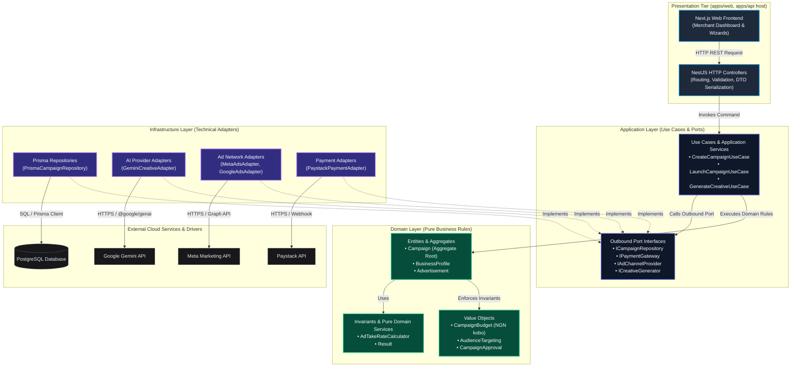

# Boost Market — Internal Layered Architecture (Domain, Application, Infrastructure)

**Document Version:** 1.0.0  
**Status:** Approved Architectural Baseline  
**Date:** 2026-10-30  
**Author:** Muhammad Kabeer Ahmed & Core Engineering Team  
**Governing Documents:**  
- [Application Boundaries (Macro-Architecture)](./application-boundaries.md)  
- [ADR-001: Monorepo and Modular Clean Architecture](../adr/ADR-001-monorepo-modular-clean-architecture.md)  
- [Development Standards](../standards/DEVELOPMENT_STANDARDS.md)

---

## 1. Purpose

This document defines the **internal architectural layers** of the Boost Market platform. While `docs/architecture/application-boundaries.md` established the macro-level boundaries between deployable applications (`apps/web`, `apps/api`) and shared packages (`packages/shared`, `packages/ai`, `packages/config`), this document governs the **internal structural layers** that organize code within those boundaries:

1. **The Domain Layer:** Pure enterprise business rules, entities, value objects, and domain invariants.
2. **The Application Layer:** Business use cases, workflow orchestrators, and inbound/outbound port definitions.
3. **The Infrastructure Layer:** Technical implementations of external ports (databases, external ad networks, AI SDKs, payment gateways, message queues).

The goal of this architecture is to ensure that Boost Market can scale to support complex AI agentic workflows, multi-channel advertising distribution (Meta, Google Ads), and high-volume local payments (Paystack, Flutterwave) without permitting any third-party framework, database, or vendor SDK to dictate, leak into, or constrain enterprise business logic.

---

## 2. Architectural Principles

The internal layering follows **Clean Architecture**, **Hexagonal Ports & Adapters**, and **Domain-Driven Design (DDD)** principles:

1. **The Inward Dependency Rule:**  
   Dependencies flow strictly inward:
   $$\text{Infrastructure Layer} \longrightarrow \text{Application Layer} \longrightarrow \text{Domain Layer}$$
   - The Domain Layer has **zero dependencies** on outer layers, frameworks, or libraries.
   - The Application Layer depends **only on the Domain Layer**.
   - The Infrastructure Layer depends on the Application and Domain Layers by implementing the abstract interfaces (ports) they declare.
2. **Separation of Concerns:**  
   - Business rules live in the Domain.
   - Workflow choreography lives in the Application.
   - Framework routing, database storage, and network communication live in the Infrastructure / Presentation tiers.
3. **Dependency Inversion Principle (DIP):**  
   High-level business policies do not depend on low-level technical details; both depend on abstractions. Application use cases declare what they need via TypeScript `interfaces` (ports). Infrastructure modules provide concrete classes that implement those interfaces.
4. **Deterministic Authority over AI Inference:**  
   Probabilistic AI models provide recommendations, generate creative variants, and propose bid adjustments. Deterministic domain code strictly validates, enforces invariants, and commits state transitions and financial debits.
5. **Pragmatic Evolution over Premature Complexity:**  
   Patterns such as Command Query Responsibility Segregation (CQRS) or Event Sourcing are reserved for specific performance bottlenecks rather than introduced as generic boilerplate.

---

## 3. Domain Layer

### 3.1. Core Responsibilities
The Domain Layer is the conceptual core of Boost Market. It represents pure business logic, enterprise models, and business calculations that would remain true even if the application were operated manually with paper ledgers.

The Domain Layer is responsible for:
- **Entities & Aggregates:** Maintaining identity, lifecycle transitions, and business invariants across related objects.
- **Value Objects:** Modeling immutable concepts defined entirely by their attributes with self-validating constructors.
- **Domain Services:** Encapsulating pure business calculations or operations involving multiple entities where no single entity is the sole owner.
- **Domain Events (Recording & Exposure):** Recording significant business occurrences (`CampaignApprovedDomainEvent`, `CampaignLaunchInitiatedDomainEvent`, `BudgetExhaustedDomainEvent`) within aggregate instances to decouple cross-domain side effects. Entities and aggregates accumulate or expose these events locally (e.g., via an internal event collection or result object); they **must never directly publish** events to message brokers, Redis, queues, or external networks.
- **Explicit State Transitions & Invariants:** Enforcing deterministic lifecycle progression governed strictly by business invariants (e.g., transitioning from `DRAFT` $\rightarrow$ `APPROVED` $\rightarrow$ `LAUNCH_PENDING` $\rightarrow$ `ACTIVE`, forbidding arbitrary state mutation from outer layers).
- **Domain Invariants:** Enforcing non-negotiable business rules at all times (e.g., "A campaign cannot be launched without an active budget and verified merchant profile").
- **Domain-Specific Errors & Results:** Emitting deterministic business outcomes using the `Result<T, DomainError>` pattern without throwing unhandled runtime exceptions.

### 3.2. Boost Market Domain Concepts & Examples

| Concept Type | Domain Concept | Realistic Boost Market Responsibility & Invariants |
| :--- | :--- | :--- |
| **Aggregate Root** | `Campaign` | Governs campaign lifecycle through explicit, invariant-governed transitions (illustrative flow: `DRAFT` $\rightarrow$ `APPROVED` $\rightarrow$ `LAUNCH_PENDING` $\rightarrow$ `ACTIVE`, with failure/cancellation branches; actual production state machine subject to final product requirements). Ensures total allocated ad spend across ad sets equals total campaign budget. |
| **Entity** | `BusinessProfile` | Represents the verified Nigerian merchant identity, CAC registration number, operating vertical, and compliance status. |
| **Entity** | `Advertisement` | Represents an individual ad creative unit, linking copy variants, generated media assets, headline hooks, and target landing URL. |
| **Value Object** | `CampaignBudget` | Immutable currency representation (e.g., Nigerian Naira in kobo `NGN`). Enforces that daily spend meets configured platform minimum budget policies (e.g., an illustrative, explicitly unapproved example such as ₦5,000/day used solely for architectural demonstration; product requirements must define actual business values) and total spend $\ge$ daily spend. |
| **Value Object** | `AudienceTargeting` | Immutable geographical and demographic specifications (e.g., Lagos, Abuja, age 25–45, interest tags). |
| **Value Object** | `CampaignApproval` | Immutable record of who approved the campaign (Merchant User ID, timestamp, terms acceptance hash). |
| **Entity** | `Subscription` | Manages merchant SaaS tier (Starter, Growth, Agency), active billing cycles, and feature entitlement quotas. |
| **Domain Service** | `AdTakeRateCalculator` | Pure calculation service determining platform management fee markup (e.g., 5% platform fee + VAT) based on merchant tier. |

### 3.3. Illustrative Campaign State Transitions & Domain Event Governance

Campaign lifecycles within the Domain Layer must be explicit, deterministic, and strictly governed by domain invariants. Entities do not permit direct or arbitrary property mutations (e.g., `campaign.status = "ACTIVE"` is prohibited). Instead, state transitions are initiated through explicit business methods that evaluate invariants and record domain events.

#### Illustrative State Transition Model
The following state model is provided as an illustrative architectural baseline (not an assumption of the final production state machine):

$$\text{DRAFT} \longrightarrow \text{APPROVED} \longrightarrow \text{LAUNCH\_PENDING} \longrightarrow \text{ACTIVE}$$

*Lifecycle Branch & Recovery Considerations:*
- **`DRAFT` $\rightarrow$ `APPROVED`:** Triggered when the merchant completes targeting, ad creative configuration, and explicitly accepts compliance terms.
- **`APPROVED` $\rightarrow$ `LAUNCH_PENDING`:** Triggered when the merchant commands a launch. Invariants verify that budget is valid, ad creatives are approved, and end date is in the future. The aggregate transitions to `LAUNCH_PENDING` and records a `CampaignLaunchInitiatedDomainEvent`.
- **`LAUNCH_PENDING` $\rightarrow$ `ACTIVE`:** Transitioned only after the Application Layer confirms payment authorization/deduction and successful outbound distribution dispatch.
- **`LAUNCH_PENDING` $\rightarrow$ `LAUNCH_FAILED`:** Transitioned if payment processing fails, authorization expires, or third-party ad distribution suffers unrecoverable rejection. The campaign can be re-evaluated or retried.
- **`ACTIVE` $\rightarrow$ `PAUSED` $\rightleftharpoons$ `ACTIVE`:** Allows merchants or automated budget guards to temporarily suspend ad distribution and resume it later.
- **`ACTIVE` $\rightarrow$ `COMPLETED`:** Transitioned automatically when total campaign budget or scheduled duration is exhausted.
- **`DRAFT` / `APPROVED` / `PAUSED` $\rightarrow$ `CANCELLED`:** Terminal cancellation state releasing any associated budget allocations.

#### Invariant Ownership vs. Event Publication Boundary
1. **Domain Objects Record, Never Publish:** Domain entities and aggregates instantiate and record domain events in an internal buffer (e.g., `this.addDomainEvent(new CampaignLaunchInitiatedDomainEvent(...))`). They have **zero access** to I/O, network sockets, Redis, Kafka, BullMQ, or message brokers.
2. **Application Layer Coordinates:** The Application Layer extracts recorded events from the aggregate after use case execution and coordinates publication via outbound port interfaces.
3. **Infrastructure Layer Implements:** Concrete adapters in the Infrastructure Layer provide the physical transmission of event messages to external queues or event buses.
4. **Business Rule Definition Authority:** The Domain Layer owns the structural enforcement of business rules and invariants, but product requirements and business stakeholders must establish the actual rules, allowable thresholds, and business policies.

### 3.4. Strict Prohibitions
The Domain Layer **must never import or depend on**:
- NestJS decorators or modules (`@Injectable()`, `@Controller()`, `@nestjs/*`).
- Next.js or React runtime APIs (`'use client'`, `useEffect`, `next/navigation`).
- Prisma client or schema objects (`@prisma/client`, Prisma DMMF).
- Relational databases, SQL drivers, or ORM annotations (`pg`, `typeorm`, `drizzle`).
- In-memory data stores or cache clients (`ioredis`, Redis SDK).
- Third-party AI SDKs (`@google/genai`, `openai`, `anthropic`).
- Ad network APIs (`facebook-nodejs-business-sdk`, Google Ads API client).
- Payment provider SDKs (`paystack`, `stripe`).
- Global environment reading (`process.env`).

---

## 4. Application Layer

### 4.1. Core Responsibilities
The Application Layer choreographs business workflows. It directs domain entities to enforce rules, invokes infrastructure ports to fetch and save data, and manages transactional boundaries. It answers the question: *"What does the system do in response to a user or external trigger?"*

The Application Layer is responsible for:
- **Use Cases / Application Services:** Orchestrating discrete user interactions and business capabilities (e.g., `CreateCampaignUseCase`, `LaunchCampaignUseCase`).
- **Input DTOs & Validation Contracts:** Accepting strongly-typed command or query payloads from the presentation tier.
- **Port Interfaces (Dependency Inversion Boundaries & Consumer Ownership):**
  - *Consumer-Owned Outbound Ports:* In adherence to the Dependency Inversion Principle, interfaces (ports) are generally owned and defined by the **application capability or module that consumes them**, rather than by infrastructure adapters or generic shared buckets.
    - `ICampaignRepository`: Owned by the campaign application capability (the campaign orchestration module defines the persistence contract it requires to load and save `Campaign` aggregates).
    - `IPaymentGateway`: Owned by the application capability coordinating payment and billing (the payment coordination use case specifies the operations it requires).
    - `ICreativeGenerator`: May be provided by the specialized contracts package (`packages/ai`) if and only if it represents a genuinely reusable, provider-neutral capability contract designed for broad monorepo consumption.
  - *Prohibition on Arbitrary Interface Dumping:* Interfaces should **not automatically be placed in `packages/shared` or `packages/ai` merely because they are interfaces**. Misplacing feature-specific interfaces into global shared packages blurs bounded contexts, causes false coupling, and violates `docs/architecture/application-boundaries.md`.
  - *Inbound Ports:* Interfaces exposing use case operations to controllers or CLI tasks.
- **Transaction & Workflow Coordination:** Coordinating state transitions across aggregates. Crucially, coordinating external payment operations, local database persistence, and background queue dispatch **cannot automatically be treated as one atomic database transaction**. The Application Layer must explicitly design for distributed consistency across these heterogeneous boundaries.
- **Authorization Enforcement Coordination:** Validating that the acting user has permission to operate on the target aggregate before calling domain logic.
- **Coordinating Domain Event Publication:** Extracting domain events recorded by domain aggregates upon successful use case execution and publishing them reliably (e.g., via a Transactional Outbox pattern or event publisher contract) without coupling domain objects to external message brokers.

### 4.2. Realistic Boost Market Use Case Examples

1. **`CreateBusinessProfileUseCase`:**  
   Receives business name, CAC number, and contact details; checks uniqueness via `IBusinessProfileRepository`; constructs `BusinessProfile` entity; persists and returns profile summary.
2. **`GenerateAdvertisementCreativeUseCase`:**  
   Receives campaign objectives and audience parameters; invokes `ICreativeGenerator` port (implemented by Gemini/OpenAI adapter); parses candidate headlines and copy; passes results to domain for compliance checking.
3. **`CreateCampaignUseCase`:**  
   Validates merchant eligibility; instantiates `Campaign` aggregate root in `DRAFT` status; associates ad creatives; commits to `ICampaignRepository`.
4. **`ApproveCampaignUseCase`:**  
   Enforces merchant review checklist; verifies explicit terms agreement; updates aggregate state to `APPROVED`.
5. **`LaunchCampaignUseCase`:**  
   Coordinates campaign deployment across distributed boundaries: validates prerequisites, transitions `Campaign` aggregate to `LAUNCH_PENDING`, coordinates payment authorization with `IPaymentGateway`, persists state changes and outbox event records atomically in PostgreSQL, and hands off distribution to asynchronous background job queues (`IJobQueue`) for Meta/Google execution.
6. **`ProcessPaymentWebhookUseCase`:**  
   Receives validated webhook event from Paystack adapter; credits merchant balance in wallet aggregate; unlocks campaigns pending payment.

### 4.3. Pragmatic Evolution & Architectural Complexity
- **Use Cases vs. Full CQRS:**  
  For current and near-term operations, simple Use Cases returning `Result<T, E>` provide clear, maintainable orchestration without the overhead of maintaining separate read/write data models, MediatR-style message buses, or eventual consistency pipelines.
- **When CQRS Becomes Useful:**  
  CQRS should be introduced selectively only when read workloads (e.g., merchant analytics dashboards displaying real-time aggregated impressions across thousands of ads) require specialized denormalized read models distinct from the transactional aggregate tables.

---

## 5. Infrastructure Layer

### 5.1. Core Responsibilities
The Infrastructure Layer contains all concrete implementations of technical mechanisms. It bridges the pure interfaces declared by the Application Layer with real databases, third-party network APIs, filesystem storage, and hardware clocks.

The Infrastructure Layer is responsible for:
- **Database Repositories & Adapters:** Implementing persistence ports using Prisma and PostgreSQL (e.g., `PrismaCampaignRepository`, `PrismaBusinessProfileRepository`).
- **External AI Provider Adapters:** Implementing `ICreativeGenerator` and `IReasoningEngine` using official SDKs (e.g., `GeminiCreativeAdapter` using `@google/genai`, `OpenAICreativeAdapter`).
- **Advertising Platform Adapters:** Implementing `IAdChannelProvider` by calling Meta Graph API and Google Ads REST APIs (e.g., `MetaMarketingAdapter`, `GoogleAdsAdapter`).
- **Payment Gateway Adapters:** Implementing `IPaymentGateway` using Paystack API (e.g., `PaystackPaymentAdapter`).
- **Messaging & Notifications:** Implementing SMS (`TermiiSMSAdapter`), WhatsApp, and transactional email (`SendGridEmailAdapter`).
- **Background Jobs & Message Queues:** Managing asynchronous worker execution, retry policies, and scheduled cron jobs (e.g., Redis / BullMQ adapters).
- **Environment & Secret Configuration:** Reading environment variables safely via `@boost-market/config`.

### 5.2. Realistic Boost Market Infrastructure Examples

```text
┌────────────────────────────────────────────────────────────────────────┐
│                        INFRASTRUCTURE ADAPTERS                         │
├─────────────────────────┬──────────────────────┬───────────────────────┤
│ Concrete Adapter        │ Application Port     │ External Technology   │
├─────────────────────────┼──────────────────────┼───────────────────────┤
│ PrismaCampaignRepo      │ ICampaignRepository  │ Prisma ORM / Postgres │
│ GeminiCreativeAdapter   │ ICreativeGenerator   │ @google/genai SDK     │
│ MetaMarketingAdapter    │ IAdChannelProvider   │ Meta Marketing API    │
│ GoogleAdsAdapter        │ IAdChannelProvider   │ Google Ads REST API   │
│ PaystackPaymentAdapter  │ IPaymentGateway      │ Paystack REST API     │
│ BullMQJobQueueAdapter   │ IJobQueue            │ Redis / BullMQ        │
│ TermiiNotificationAdapter│ INotificationService │ Termii SMS API        │
└─────────────────────────┴──────────────────────┴───────────────────────┘
```

---

## 6. Layered Architecture & Dependency Flow Diagram



---

## 7. Examples of Appropriate vs. Inappropriate Code Placement

### Scenario 1: Minimum Daily Ad Spend Validation (Configurable Policy Enforcement)
* **Illustrative Policy (Unapproved Example):** An advertising campaign must satisfy a minimum daily ad spend threshold (illustrated here using an arbitrary ₦5,000/day threshold solely for architectural demonstration; product requirements and business governance must establish the actual approved policy and numeric values).
* ❌ **Inappropriate Placement:**
  - In a Next.js React component form handler (`apps/web`): Client can easily bypass validation via curl or Postman.
  - In a NestJS controller or DTO pipe (`apps/api`): Ties business rules to HTTP framework; if campaigns are created via background jobs or cron scripts, validation is missed.
  - In a PostgreSQL check constraint (`infrastructure`): Database errors are unhelpful, hard to unit-test, and too late in the lifecycle.
* ✅ **Appropriate Placement:**
  - Inside the `CampaignBudget` Value Object in the **Domain Layer**. The Value Object constructor verifies adherence to the configured platform budget policy, returning `Result.fail(DomainErrors.BudgetBelowMinimum)` whenever instantiated with a value below the invariant threshold.
  - *Governance Clarification:* The Domain Layer owns the structural and invariant enforcement of business rules, but product requirements must establish the actual rule and its value. Engineering does not invent or approve business policy values.

### Scenario 2: Generating Creative Copy Variants Using Gemini
* **Rule:** Merchant requests 3 AI-generated ad headline variations based on a campaign prompt.
* ❌ **Inappropriate Placement:**
  - Inside the `Advertisement` entity (`domain`): Pollutes the pure domain model with third-party SDK dependencies (`@google/genai`) and network I/O.
  - Inside a NestJS controller (`presentation`): Controller now handles prompt engineering, retries, vendor exceptions, and serialization.
* ✅ **Appropriate Placement:**
  - **Application Layer:** `GenerateAdvertisementCreativeUseCase` accepts prompt parameters and invokes the `ICreativeGenerator` port.
  - **Infrastructure Layer:** `GeminiCreativeAdapter` implements `ICreativeGenerator`, calls `@google/genai`, parses the structured JSON response, and returns domain-compatible DTOs.

### Scenario 3: Deducting Campaign Budget from Merchant Wallet
* **Rule:** When a campaign launches, the required budget must be debited from the merchant's prepaid balance or pre-authorized via payment gateway.
* ❌ **Inappropriate Placement:**
  - Directly in `PrismaCampaignRepository`: Repositories only persist and retrieve aggregates; they do not coordinate financial deductions or payment gateway handshakes.
* ✅ **Appropriate Placement:**
  - **Application Layer:** `LaunchCampaignUseCase` coordinates multi-step execution across operational boundaries: authorizes funds via `IPaymentGateway`, invokes `campaign.initiateLaunch()` (transitioning to `LAUNCH_PENDING`), and commits aggregate changes and outbox records in a local database transaction. It explicitly accounts for the fact that external payment calls and local database writes cannot be a single atomic database transaction.

---

## 8. Realistic Execution Flow: Launching an Advertising Campaign

This walkthrough illustrates the exact sequence and responsibilities of each layer when a Nigerian business owner clicks **"Launch Campaign"** in the Boost Market portal.

```text
[Browser / Merchant UI]
       │
       │ 1. POST /api/v1/campaigns/cmp_123/launch (Bearer JWT)
       ▼
[Presentation Tier: NestJS Controller]
       │
       │ 2. Authenticates JWT, extracts TenantId & UserId.
       │    Invokes LaunchCampaignUseCase.execute({ campaignId, merchantId })
       ▼
[Application Layer: LaunchCampaignUseCase]
       │
       │ 3. Fetches Campaign aggregate via ICampaignRepository outbound port.
       │    Verifies caller owns the campaign aggregate.
       ▼
[Domain Layer: Campaign Aggregate Root]
       │
       │ 4. Executes campaign.initiateLaunch(currentClockTime).
       │    Validates Domain Invariants:
       │    - Status must currently be APPROVED (cannot launch DRAFT).
       │    - Budget must be valid and funded.
       │    - End date must be in the future.
       │    - Ad creatives must be approved and non-empty.
       │    Transitions status: APPROVED ──> LAUNCH_PENDING.
       │    Records CampaignLaunchInitiatedDomainEvent internally (zero external I/O).
       ▼
[Application Layer: LaunchCampaignUseCase]
       │
       │ 5. Coordinates Distributed Operational Boundaries:
       │    a. Invokes IPaymentGateway (funds hold / authorization with idempotency key).
       │    b. Within a local PostgreSQL ACID transaction:
       │       - ICampaignRepository.save(campaign) commits state (LAUNCH_PENDING).
       │       - Writes distribution intent to Transactional Outbox table.
       │    c. Transactional outbox relay publishes to IJobQueue.

       ▼
[Infrastructure Layer: Asynchronous Job Worker]
       │
       │ 6. Background worker consumes job with idempotency and retry:
       │    - Invokes MetaMarketingAdapter (IAdChannelProvider) via Graph API.
       │    - Invokes GoogleAdsAdapter (IAdChannelProvider) via REST API.
       │    - Stores external platform Campaign IDs (meta_campaign_id, etc.).
       │    - On success: transitions campaign state LAUNCH_PENDING ──> ACTIVE.
       │    - On failure: marks LAUNCH_FAILED and triggers compensation/alerts.
       ▼
[Presentation Tier: Response]
       │
       │ 7. Returns HTTP 202 Accepted { success: true, status: "LAUNCH_PENDING" } to merchant.
```

### Critical Architectural Nuances in this Flow:
1. **Deterministic Authority over AI Recommendations:**  
   If an AI optimization agent had previously suggested *"Increase daily budget by 20% to capture weekend shopper traffic,"* that suggestion was merely a candidate proposal. The campaign cannot launch or spend money until the merchant explicitly reviewed and approved that budget in the domain model. AI inference is strictly advisory; deterministic software commits the transaction.
2. **Financial Transaction Consistency & Distributed Coordination:**  
   Coordinating external payment operations, local database persistence, and background job dispatch introduces critical distributed systems challenges. These operations **cannot automatically or naively be treated as one single atomic database transaction**:
   - **The Limits of Database Transactions:** A PostgreSQL ACID transaction (`BEGIN ... COMMIT`) guarantees atomicity, consistency, isolation, and durability strictly within its own storage engine. It cannot encompass external third-party HTTP network calls (e.g., Paystack, Flutterwave) or independent message brokers (e.g., Redis, BullMQ).
   - **Distributed Coordination Failure Modes:**
     - *Payment succeeds, Database write fails:* If an external payment gateway charges or reserves funds over HTTPS, but the local database crashes or times out before committing `campaign.status = LAUNCH_PENDING`, merchant funds have been locked with no local record of the launch.
     - *Database write succeeds, Queue dispatch fails (The Dual-Write Problem):* If the local database commits the status change, but the server crashes before enqueueing the job to Redis/BullMQ, the campaign is stranded in `LAUNCH_PENDING` indefinitely.
     - *Queue worker executes, External ad platform network times out:* If Meta/Google APIs time out after processing an ad creation request, a naive worker retry could create duplicate ad campaigns and incur double ad spend.
   - **Architectural Requirements & Future Implementation Considerations:**
     - *Idempotency:* All external payment requests, background jobs, and webhook handlers must require deterministic idempotency keys (e.g., combining merchant ID, campaign ID, and attempt timestamp). This ensures that retries over unreliable networks never produce duplicate financial debits or duplicate external ad campaigns.
     - *Explicit Operation & Campaign States:* The domain model must represent fine-grained intermediate states (e.g., `APPROVED` $\rightarrow$ `LAUNCH_PENDING` $\rightarrow$ `ACTIVE` or `LAUNCH_FAILED`) rather than jumping across boundaries. Each state represents a distinct, auditable checkpoint.
     - *Transactional Outbox Pattern:* To eliminate dual-write vulnerabilities between PostgreSQL and Redis/BullMQ, the Application Layer persists the aggregate state change and the outbound event/job record atomically within the same local PostgreSQL database transaction. A separate, reliable outbox processor (or change data capture relay) reads committed outbox entries and publishes them to the message broker with at-least-once delivery semantics.
     - *Retry and Reconciliation Strategies:* Distributed operations require automated reconciliation. The system must implement exponential backoff retries with jitter, idempotent webhook handlers (e.g., listening for Paystack/Flutterwave charge success or failure events), and periodic reconciliation cron jobs that poll payment gateways to resolve in-flight or stalled operations.
     - *Compensation & Recovery Mechanisms:* When an upstream operation succeeds (such as reserving merchant funds) but downstream operations suffer unrecoverable failures (such as ad network policy rejection), the system must execute compensating actions—such as voiding the authorization hold, releasing the budget reservation, issuing an automated wallet credit, or alerting operations personnel.
     - *Provider-Specific Capabilities:* Payment workflows cannot be prescribed as a monolithic, one-size-fits-all sequence without acknowledging provider-specific capabilities. For example:
       - Paystack and Flutterwave have differing tokenization mechanics, webhook verification structures, and transaction query APIs.
       - True authorization holds (pre-authorization) vs. immediate charge capture vs. internal merchant wallet balance deductions present fundamentally different failure windows and settlement lifecycles.
       - Future implementation tasks must design dedicated adapters tailored to the concrete capabilities of each provider rather than assuming generic gateway behavior.

3. **Synchronous User Response vs. Asynchronous Workflows:**  
   The HTTP request **does not wait** for external ad networks (Meta, Google) to review, ingest, or activate ads over external networks. The presentation tier responds immediately (HTTP 202 Accepted) once the aggregate has entered `LAUNCH_PENDING` and the outbox record is committed. Background workers then handle the potentially slow or flaky third-party integrations asynchronously, maintaining rapid UI responsiveness.

---

## 9. Junior Engineer Technical Defense Guide

*How to defend this layered architecture in technical reviews, interviews, or PR debates:*

1. **Question:** *"Why can't I just inject the Prisma client directly into my NestJS controller to fetch and update the campaign quickly?"*  
   **Defense:** "If we put Prisma queries in controllers, our business rules become scattered across HTTP handlers. When we later need to launch campaigns from a background worker, a scheduled cron task, or a webhook, we would have to duplicate that logic. Furthermore, we wouldn't be able to unit-test our campaign validation rules without spinning up a live PostgreSQL database."

2. **Question:** *"Why do we need an `ICampaignRepository` interface when we know we are using Prisma and PostgreSQL?"*  
   **Defense:** "The `ICampaignRepository` port lets the Application Layer state *what* persistence operations it requires without caring *how* Prisma achieves them. This allows us to run lightning-fast unit tests using in-memory repository doubles without touching a database, and protects our core codebase if Prisma changes its API or if we swap storage engines."

3. **Question:** *"Why can't the `Campaign` domain entity call the Gemini API directly to validate ad copy?"*  
   **Defense:** "Domain entities must remain pure, deterministic TypeScript objects with zero network I/O. If an entity calls an external network API, unit tests become slow, flaky, and dependent on API keys, network availability, and third-party rate limits. Instead, the Application Layer calls the AI port, collects the generated text, and passes it into the domain entity as a simple, testable string value."

---

## 10. Current Implementation State vs. Future Considerations

### 10.1. Current Workspace Reality
As inspected during Subtask 0.1.2.2:
- **Domain Layer:** The pure `Result<T, E>` pattern and foundational status primitives (`SystemStatus`, `Environment`) are established in `packages/shared`. Enterprise business aggregates (`Campaign`, `BusinessProfile`) do not yet exist in code and are scheduled for implementation in Task 0.1.3.
- **Application Layer:** AI port abstractions (`IAIProviderContract`, `AIModelMetadata`) are defined in `packages/ai`. Application use cases have not yet been instantiated.
- **Infrastructure Layer:** Configuration validation (`packages/config`) and basic NestJS application hosting (`apps/api`) are operational. Concrete adapters for Prisma, Meta, and Paystack are architectural targets, not existing implementations.

### 10.2. Future Considerations
1. **Repository & Package Structure:**  
   Task 0.1.3 will introduce `@boost-market/domain` (or dedicated domain modules) to house the pure enterprise entities and value objects defined in this document.
2. **Background Job Queues:**  
   External ad platform communication and heavy creative generation should be executed via asynchronous workers (e.g., BullMQ with Redis), keeping HTTP response times under 200ms for merchant operations.
3. **Transactional Outbox & Event Publishing:**  
   As domain events proliferate (`CampaignApprovedDomainEvent`, `CampaignLaunchInitiatedDomainEvent`), a Transactional Outbox pattern and reliable event publishing relay will be formalized in the Application and Infrastructure Layers to decouple message queue dispatches from local ACID database commits without dual-write failure risks.
