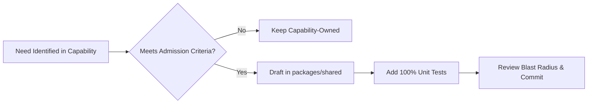
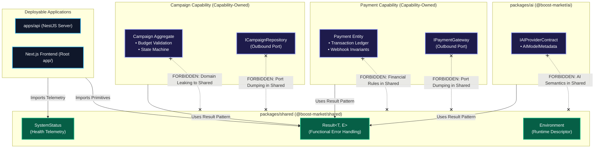

# Boost Market — Shared-Kernel Boundaries & Domain Partitioning

**Document Version:** 1.0.0  
**Status:** Approved Architectural Baseline  
**Date:** 2026-10-30  
**Author:** Muhammad Kabeer Ahmed & Core Engineering Team  
**Governing Documents:**  
- [Application Boundaries (Macro-Architecture)](./application-boundaries.md)  
- [Internal Layered Architecture (Domain, Application, Infrastructure)](./layered-architecture.md)  
- [Dependency-Direction Rules](./dependency-direction-rules.md)  
- [ADR-001: Monorepo and Modular Clean Architecture](../adr/ADR-001-monorepo-modular-clean-architecture.md)  
- [ADR-002: Engineering Standards and AI Governance](../adr/ADR-002-engineering-standards-and-ai-governance.md)  
- [Development Standards](../standards/DEVELOPMENT_STANDARDS.md)

---

## 1. Purpose & Context

This document establishes the **strict architectural boundaries of the Shared Kernel** (`packages/shared` / `@boost-market/shared`) within the Boost Market monorepo. It explicitly defines:
1. What qualifies for admission into the Shared Kernel.
2. What must remain strictly owned by individual business capabilities (Campaigns, Payments, Identity, Advertising, AI).
3. The fundamental distinction between shared technical primitives and capability-owned business rules.
4. The governance model for introducing, modifying, or deprecating shared abstractions.

Boost Market is an agentic AI advertising SaaS platform managed via **Bun workspaces** and running on **Node.js 22**. As the codebase evolves to support Nigerian merchants across complex workflows—such as multi-channel campaign planning, Gemini/OpenAI copy generation, Paystack/Flutterwave billing, and Meta/Google distribution—disciplined shared-kernel boundaries ensure that `packages/shared` never degenerates into a convenient dumping ground for common code.

---

## 2. The Shared Kernel in Domain-Driven Design (DDD)

### 2.1. Theoretical Definition in DDD

In Domain-Driven Design (DDD), Eric Evans defines the **Shared Kernel** as a subset of the domain model that multiple bounded contexts or teams explicitly agree to share:

> *"Designate some subset of the domain model that the two teams agree to share. Of course, this includes, along with this subset of the model, the subset of the code or of the database design associated with that part of the model. This explicitly shared stuff has special status, and shouldn't be changed without consultation with the other team."* — Eric Evans, *Domain-Driven Design*

In a modular monorepo like Boost Market, `packages/shared` serves as the foundational shared kernel. However, this architectural pattern carries significant risks if its boundaries are misunderstood.

### 2.2. The Core Risks of Mismanaged Sharing

1. **Monorepo-Wide Blast Radius:**  
   `packages/shared` sits at the very bottom of the dependency graph. Every application (`apps/api`, the Next.js frontend) and sibling package (`packages/config`, `packages/ai`) depends on it. Any breaking change, subtle bug, or performance degradation in `packages/shared` propagates instantly across the entire codebase.
2. **Artificial Semantic Coupling:**  
   Sharing a type between two capabilities creates coupling. If Capability A and Capability B share a model, any change required by Capability A forces Capability B to adapt, even if Capability B's business domain has not changed.
3. **The "Common Code" Anti-Pattern:**  
   Without strict boundaries, developers use the shared kernel to avoid making ownership decisions. It rapidly accumulates utility functions, half-baked helpers, mixed DTOs, and orphaned interfaces, destroying modularity.
4. **Sharing Types vs. Sharing Business Responsibility:**  
   Sharing a low-level type (such as `string` or a generic `Result<T, E>`) is purely technical. It does **not** grant permission to share domain business logic, validation rules, or state machines across capabilities.
5. **The Imperative for an Intentionally Small Kernel:**  
   A healthy Shared Kernel is **intentionally minimal**. The smaller the shared surface area, the greater the autonomy of individual business capabilities, and the lower the risk of cascading build breaks.

### 2.3. The Five Architectural Categories of Code

To prevent confusion, Boost Market categorizes code into five distinct tiers:

```text
┌────────────────────────────────────────────────────────────────────────┐
│                   FIVE CODE CATEGORIES IN BOOST MARKET                 │
├──────────────────────────┬──────────────────────┬──────────────────────┤
│ Category                 │ Definition           │ Boost Market Example │
├──────────────────────────┼──────────────────────┼──────────────────────┤
│ 1. Shared Technical      │ Domain-neutral, pure │ Result<T, E>,        │
│    Primitives            │ technical utilities  │ SystemStatus         │
├──────────────────────────┼──────────────────────┼──────────────────────┤
│ 2. Shared Domain         │ Universal domain     │ Currency code enum   │
│    Primitives            │ concepts without     │ (NGN, USD)           │
│                          │ capability logic     │                      │
├──────────────────────────┼──────────────────────┼──────────────────────┤
│ 3. Capability-Owned      │ Pure business rules, │ Campaign aggregate,  │
│    Domain Models         │ entities, invariants │ Payment entity       │
├──────────────────────────┼──────────────────────┼──────────────────────┤
│ 4. Application Contracts │ Outbound ports owned │ ICampaignRepository, │
│    (Ports)               │ by use cases         │ IPaymentGateway      │
├──────────────────────────┼──────────────────────┼──────────────────────┤
│ 5. Infrastructure        │ Technical drivers &  │ PrismaCampaignRepo,  │
│    Implementations       │ third-party adapters │ PaystackPaymentAdapt │
└──────────────────────────┴──────────────────────┴──────────────────────┘
```

**Rule:** `packages/shared` is reserved **exclusively for Category 1 and strictly vetted Category 2 abstractions**. Categories 3, 4, and 5 must **never** enter `packages/shared`.

---

## 3. Inventory and Evaluation of Current `packages/shared`

An inspection of [`packages/shared`](file:///c:/Users/DELL/Desktop/boostmarket/packages/shared) reveals three existing abstractions:

```text
packages/shared/
├── package.json
├── tsconfig.json
└── src/
    ├── index.ts        # Barrel export
    ├── result.ts       # Result<T, E> pattern
    └── types.ts        # Environment & SystemStatus
```

### Detailed Evaluation of Existing Primitives

| Abstraction | Source File | Purpose | Shared Justification | Domain Neutral? | External Dependencies? | Status & Recommendation |
| :--- | :--- | :--- | :--- | :---: | :---: | :--- |
| **`Result<T, E>`** | [`result.ts`](file:///c:/Users/DELL/Desktop/boostmarket/packages/shared/src/result.ts) | Functional Either pattern for deterministic error handling without throwing exceptions. | Used universally across config validation, domain invariants, and use cases. | **Yes** (100% technical) | **None** (Pure TypeScript) | **Approved to Remain.** Model implementation of a shared technical primitive. |
| **`SystemStatus`** | [`types.ts`](file:///c:/Users/DELL/Desktop/boostmarket/packages/shared/src/types.ts) | Structural contract for system operational health (`healthy`, `degraded`, `unhealthy`). | Shared between `apps/api` health endpoint and frontend status indicators. | **Yes** (Operational telemetry) | **None** (Pure TypeScript) | **Approved to Remain.** Stable cross-tier telemetry contract. |
| **`Environment`** | [`types.ts`](file:///c:/Users/DELL/Desktop/boostmarket/packages/shared/src/types.ts) | Union type for execution environments (`development`, `staging`, `production`, `test`). | Shared runtime indicator for configuration parsing and test assertions. | **Yes** (Runtime metadata) | **None** (Pure TypeScript) | **Approved to Remain.** Universal environment descriptor. |

### Current Consumer Inventory (Actual vs. Proposed)

* **Actual Existing Consumers in Repository:**
  - `Result<T, E>` is actively imported by:
    - [`packages/config/src/env.validator.ts`](file:///c:/Users/DELL/Desktop/boostmarket/packages/config/src/env.validator.ts#L1) (validates server/public env).
    - [`tests/sanity.test.ts`](file:///c:/Users/DELL/Desktop/boostmarket/tests/sanity.test.ts#L3) (verifies foundational result behavior).
  - `SystemStatus` is actively imported by:
    - [`apps/api/src/health.controller.ts`](file:///c:/Users/DELL/Desktop/boostmarket/apps/api/src/health.controller.ts#L2) (exposes GET `/health`).
    - [`app/page.tsx`](file:///c:/Users/DELL/Desktop/boostmarket/app/page.tsx#L20) (renders live status badge in root dashboard).
    - [`tests/helpers/test-builders.ts`](file:///c:/Users/DELL/Desktop/boostmarket/tests/helpers/test-builders.ts#L1) (constructs mock status objects).
* **Proposed Future Consumers (Anticipated):**
  - Future domain aggregates (`Campaign`, `BusinessProfile`) will use `Result<T, DomainError>`.
  - Future application use cases will return `Result<DTO, ApplicationError>`.

---

## 4. Admission Criteria for the Shared Kernel

An abstraction may be added to `packages/shared` **if and only if** it satisfies all six admission criteria:

1. **Multi-Consumer Requirement:**  
   The abstraction must be required by at least two independent workspace applications or packages (e.g., consumed by both `apps/api` and the web frontend, or by `packages/config` and future domain packages), OR represent an approved, cross-cutting architectural standard (such as `Result<T, E>`). *Convenience for a single consumer is strictly disqualified.*
2. **Proven Semantic Stability:**  
   The candidate abstraction must represent a mature, stable concept whose interface is not subject to frequent product changes. Volatile or rapidly evolving schemas are disqualified.
3. **Domain Neutrality:**  
   The abstraction must not embody business logic, operational workflows, or regulatory rules belonging naturally to a specific capability (e.g., campaign budget rules, payment fee calculations, CAC registration formats).
4. **Zero Framework & Vendor Dependencies:**  
   The abstraction must be written in **100% pure TypeScript**. It must never import NestJS, Next.js, React, Prisma, Redis, `@google/genai`, Paystack, or any external npm runtime dependency.
5. **Clear Blast-Radius Assessment:**  
   The author must document that a future change to the abstraction will not force breaking changes across unrelated bounded contexts.
6. **Comprehensive Automated Test Coverage:**  
   The abstraction must be fully covered by deterministic unit tests in `tests/unit/` using the native Node.js test runner (`bun test`), with zero network or filesystem mocks.

---

## 5. Exclusion Criteria: What Must Remain Capability-Owned

The table below documents specific concepts that **must never be admitted to `packages/shared`**, identifying their rightful architectural owners.

```text
┌────────────────────────────────────────────────────────────────────────────────────────┐
│                   CAPABILITY-OWNED EXCLUSIONS (FORBIDDEN IN SHARED)                    │
├────────────────────┬──────────────────────────────────┬────────────────────────────────┤
│ Capability         │ Prohibited Concepts              │ Rightful Architectural Owner   │
├────────────────────┼──────────────────────────────────┼────────────────────────────────┤
│ Campaign           │ Campaign entity, aggregate root, │ Campaign Domain & Application   │
│ Management         │ lifecycle states (DRAFT->ACTIVE),│ modules in apps/api            │
│                    │ budget validation, ICampaignRepo │ (future @boost-market/domain)  │
├────────────────────┼──────────────────────────────────┼────────────────────────────────┤
│ Payments &         │ Payment entity, wallet balance,  │ Billing & Payment capability   │
│ Billing            │ Paystack/Flutterwave webhooks,   │ in apps/api                    │
│                    │ refund rules, IPaymentGateway    │                                │
├────────────────────┼──────────────────────────────────┼────────────────────────────────┤
│ Identity &         │ Merchant profile, CAC validation,│ Identity & Merchant capability │
│ Access             │ JWT claims, user roles, RBAC,    │ in apps/api                    │
│                    │ IBusinessProfileRepository       │                                │
├────────────────────┼──────────────────────────────────┼────────────────────────────────┤
│ Advertising        │ Meta/Google ad channel ports,    │ Ad Distribution capability     │
│ Distribution       │ audience targeting schemas,      │ in apps/api                    │
│                    │ IAdChannelProvider               │                                │
├────────────────────┼──────────────────────────────────┼────────────────────────────────┤
│ AI Creative        │ ICreativeGenerator, prompt text, │ Dedicated packages/ai          │
│ & Reasoning        │ provider routing policies,       │ contracts & api AI adapters    │
│                    │ token usage telemetry            │                                │
├────────────────────┼──────────────────────────────────┼────────────────────────────────┤
│ Infrastructure     │ PrismaClient, Redis caches,      │ Infrastructure Layer &         │
│ & Persistence      │ BullMQ queues, database queries, │ concrete adapters in apps/api  │
│                    │ HTTP clients (Axios, Fetch)      │                                │
└────────────────────┴──────────────────────────────────┴────────────────────────────────┘
```

### Detailed Justification by Capability

1. **Why Campaign Logic Must Remain in Campaign Capability:**  
   The `Campaign` aggregate root enforces critical business invariants (e.g., verifying that ad creatives are approved and the end date is in the future before launching). Moving the entity, its status enum, or `ICampaignRepository` into `packages/shared` would expose internal campaign mechanics to unrelated modules (like billing or notifications), leading to inappropriate cross-domain coupling.
2. **Why Payment Logic Must Remain in Payment Capability:**  
   Payment workflows handle financial liabilities, transaction states, and ledger consistency. Placing payment models in `packages/shared` risks allowing non-payment modules to initiate charges or tamper with transaction states without passing through strict payment security guards.
3. **Why Identity & CAC Validation Must Remain in Identity Capability:**  
   Merchant identity verification involves strict compliance with Nigerian regulatory authorities (CAC, TIN). These validation rules change in response to legal requirements, not general software needs. They must remain encapsulated in the merchant identity capability.
4. **Why AI Contracts Belong in `packages/ai`, Not `packages/shared`:**  
   While AI interfaces are provider-neutral, they are not universal primitives. AI generation contracts belong in a specialized, dedicated contract package (`packages/ai`) to keep `packages/shared` strictly decoupled from AI inference semantics.
5. **Why Infrastructure Belongs in Adapters, Not `packages/shared`:**  
   Infrastructure classes connect to volatile physical mechanisms (databases, network APIs). `packages/shared` must remain completely free of network I/O, database drivers, and vendor SDKs.

---

## 6. Shared Types Versus Shared Business Rules

A critical failure mode in monorepo development is confusing **shared data types** with **shared business rules**.

### 6.1. The Fallacy of Structural Similarity
Two business concepts may share identical underlying TypeScript types (e.g., `string`, `number`, or an enum with similar labels), yet represent completely different business invariants:

* **Example: `CampaignStatus` vs. `PaymentStatus`:**
  - Both might contain a state labeled `PENDING` (`LAUNCH_PENDING` vs. `PAYMENT_PENDING`).
  - Merging them into a single `SharedStatus` in `packages/shared` is a severe architectural flaw:
    - A campaign's `PENDING` state reflects ad review and budget scheduling invariants.
    - A payment's `PENDING` state reflects banking rails, webhook verifications, and settlement latency.
    - Coupling them means any change to the payment lifecycle risks breaking the campaign state machine.
* **Example: Generic Identifiers vs. Domain Aggregate IDs:**
  - A generic type alias `export type EntityId = string;` is a harmless technical primitive.
  - A strongly-typed `CampaignId` branded type with domain-specific formatting (e.g., `cmp_[a-zA-Z0-9]{16}`) embodies business rules and belongs strictly in the Campaign domain.

### 6.2. The Money Representation Case Study

Consider the representation of financial amounts in Nigerian Naira (NGN):

```text
[Pure Technical Shared Primitive]
packages/shared:
  export interface MoneyAmount {
    readonly amountInKobo: bigint;
    readonly currency: "NGN";
  }
```

* **What May Be Shared:** The technical representation of an integer monetary unit (e.g., `bigint` representing kobo to prevent floating-point rounding errors).
* **What Must NEVER Be Shared:**
  - *Campaign Budget Rules:* "A campaign must allocate at least the platform daily minimum." This rule belongs strictly in `CampaignBudget` inside the Campaign domain.
  - *Payment Gateway Rules:* "Paystack transactions incur a 1.5% fee capped at ₦2,000." This rule belongs strictly in the Payment infrastructure adapter.
  - *Merchant Subscription Rules:* "Starter tier allows up to ₦500,000 monthly ad spend." This rule belongs strictly in the Subscription domain.

**Rule:** `packages/shared` may host the immutable currency data structure; it must **never** host business policies governing how that money is earned, capped, spent, or debited.

---

## 7. Shared-Kernel Dependency Rules

`packages/shared` occupies the root tier of the monorepo's Directed Acyclic Graph (DAG).

```text
┌────────────────────────────────────────────────────────────────────────┐
│                   PACKAGES/SHARED DEPENDENCY RESTRICTIONS              │
├───────────────────────────────────┬────────────────────────────────────┤
│ Permitted Dependencies            │ Strictly Forbidden Dependencies    │
├───────────────────────────────────┼────────────────────────────────────┤
│ • Pure TypeScript Standard Library│ • apps/api (NestJS Orchestrator)   │
│ • No external npm dependencies    │ • apps/web & root frontend (Next)  │
│                                   │ • packages/ai & packages/config    │
│                                   │ • @prisma/client & database drivers│
│                                   │ • Redis, BullMQ, Message brokers   │
│                                   │ • @google/genai, OpenAI SDKs       │
│                                   │ • Paystack, Flutterwave SDKs       │
│                                   │ • Meta Graph API, Google Ads SDKs  │
│                                   │ • tests/ & test doubles/builders   │
└───────────────────────────────────┴────────────────────────────────────┘
```

### Architectural Protection Mechanism
- **Portability:** Because `packages/shared` has zero dependencies, its code can run identically in a Node.js 22 server (`apps/api`), a browser JavaScript bundle (the Next.js frontend), a Web Worker, or an edge function.
- **Zero Transitive Bloat:** Importing `@boost-market/shared` into any file incurs zero risk of pulling in heavyweight server-only modules, secrets, or native C++ bindings.
- **Cycle Prevention:** By forbidding `packages/shared` from importing any sibling package or application, circular dependencies in the monorepo are mathematically impossible.

---

## 8. Ownership and Governance Model

To balance architectural integrity with development velocity, Boost Market employs a pragmatic governance model:

### 8.1. The Shared Abstraction Proposal Lifecycle



1. **Identification:** An engineer notices common logic or a shared contract needed across multiple capabilities.
2. **Admission Verification:** The author checks the candidate against Section 4 criteria:
   - Does it have $\ge 2$ genuine consumers?
   - Is it domain-neutral?
   - Does it have zero external dependencies?
   - Is it semantically stable?
3. **Rejection of Convenience:** If the justification is merely *"it's easier to put this here so I don't have to think about which module owns it,"* the proposal is immediately rejected.
4. **Backward Compatibility & Deprecation:**
   - Additions to `packages/shared` must be strictly backward-compatible.
   - If an existing shared primitive must change, non-breaking optional extensions are preferred.
   - Breaking changes require updating all monorepo consumers in the **same atomic pull request**, accompanied by full verification via `bun run verify`.
5. **Testing Requirement:** Every file in `packages/shared` must have a corresponding test suite in `tests/` verifying its contract.

---

## 9. Concrete Examples of Good vs. Bad Sharing

The following seven real-world Boost Market scenarios illustrate the boundary rules in practice:

### Example 1: `Result<T, E>` Pattern
* **Proposed Abstraction:** Functional Either/Result type for deterministic error handling.
* **Placement:** `packages/shared`.
* **Verdict:** ✅ **Good Sharing.**
* **Reasoning:** 100% domain-neutral, zero dependencies, universal utility across config, domain, application, and infrastructure layers.
* **Consequence of Incorrect Placement:** If each capability wrote its own error wrapper, error handling across use cases would be fragmented and incompatible.

### Example 2: `CampaignStatus` Enum
* **Proposed Abstraction:** Enum representing campaign lifecycle (`DRAFT`, `APPROVED`, `LAUNCH_PENDING`, `ACTIVE`, `PAUSED`, `COMPLETED`).
* **Placement:** `packages/shared`.
* **Verdict:** ❌ **Bad Sharing.** Belongs in Campaign capability (`apps/api/src/campaign/domain/`).
* **Reasoning:** Campaign status represents explicit business invariants and domain state transitions. It is not domain-neutral.
* **Consequence of Incorrect Placement:** Leaks campaign lifecycle mechanics into unrelated modules (billing, identity). Any campaign state change ripples through unrelated packages.

### Example 3: `PaymentStatus` Enum
* **Proposed Abstraction:** Enum representing payment transaction states (`INITIALIZED`, `FUNDS_HELD`, `CAPTURED`, `FAILED`, `REFUNDED`).
* **Placement:** `packages/shared`.
* **Verdict:** ❌ **Bad Sharing.** Belongs in Payment capability (`apps/api/src/billing/domain/`).
* **Reasoning:** Financial state transitions must be strictly protected within the payment bounded context.
* **Consequence of Incorrect Placement:** Non-payment modules might attempt to inspect or manipulate transaction lifecycles directly, violating financial integrity.

### Example 4: `Money` Value Object vs. Campaign Budget Invariants
* **Proposed Abstraction:** A class representing monetary currency (`NGN`, `kobo: bigint`) along with platform daily minimum spend checks.
* **Placement:** `packages/shared`.
* **Verdict:** ❌ **Bad Sharing.**
* **Reasoning:** The pure immutable data structure (`amountInKobo`, `currency`) could be shared, but the *budget rules* (minimum ₦5,000/day, spend $\le$ total budget) belong strictly in `CampaignBudget` in the Campaign capability.
* **Consequence of Incorrect Placement:** Hardcodes advertising budget policies into a generic monetary type, forcing billing or payroll modules to carry ad spend rules.

### Example 5: Generic Entity Identifier Primitive (`EntityId`)
* **Proposed Abstraction:** `type EntityId = string;` with UUID validation.
* **Placement:** `packages/shared`.
* **Verdict:** ✅ **Good Sharing.**
* **Reasoning:** Pure structural format helper without business semantics.
* **Consequence of Incorrect Placement:** Duplicated string format regexes across every module.

### Example 6: `ICampaignRepository` Interface
* **Proposed Abstraction:** Outbound persistence port for saving and loading campaigns.
* **Placement:** `packages/shared`.
* **Verdict:** ❌ **Bad Sharing.** Belongs in Campaign application capability (`apps/api/src/campaign/application/ports/`).
* **Reasoning:** Interfaces are consumer-driven contracts owned by the specific use case that requires them.
* **Consequence of Incorrect Placement:** Turns `packages/shared` into an interface dump and obscures capability boundaries.

### Example 7: `IAIProviderContract`
* **Proposed Abstraction:** Interface defining provider-neutral AI model metadata and availability checks.
* **Placement:** `packages/shared`.
* **Verdict:** ❌ **Bad Sharing.** Belongs in `packages/ai` (`@boost-market/ai`).
* **Reasoning:** While provider-neutral, it represents a specialized capability domain (AI orchestration). It should not pollute the universal shared kernel.
* **Consequence of Incorrect Placement:** Couples non-AI consumers to AI-specific abstractions.

---

## 10. Existing Implementation Findings & Recommendations

### 10.1. Current Workspace Reality
1. **Purity of Current `packages/shared`:**  
   [`packages/shared`](file:///c:/Users/DELL/Desktop/boostmarket/packages/shared) is currently in excellent health. It contains only `Result<T, E>`, `SystemStatus`, and `Environment`. It has **zero dependencies** in its `package.json` and zero external imports in its TypeScript files.
2. **Approved to Remain in `packages/shared`:**  
   - `Result<T, E>`: Exemplary technical primitive.
   - `SystemStatus`: Stable telemetry DTO shared across backend and frontend.
   - `Environment`: Stable runtime descriptor.
3. **Misplaced Items / Concerns:**  
   - No code in `packages/shared` is currently misplaced.
   - However, historical documentation in ADR-001 referenced `packages/shared-kernel` and `packages/domain`. The monorepo layout adopted during Task 0.1.1 formalized this as `packages/shared`. The architecture documents are aligned, and no directory renaming is warranted.
4. **Distinction of Consumers:**  
   - *Actual Consumers:* `packages/config`, `apps/api`, `app/page.tsx`, and `tests/`.
   - *Proposed Consumers:* Upcoming domain entities (`Campaign`, `BusinessProfile`) in Task 0.1.3 will consume `Result<T, E>`.

---

## 11. Junior Engineer Technical Defense Guide

*How to defend shared-kernel boundaries in code reviews and PR discussions:*

1. **Question:** *"Why can't I put `CampaignStatus` in `packages/shared` so the Next.js frontend can import it to display the campaign status badge?"*  
   **Defense:** "`CampaignStatus` represents the internal lifecycle of the Campaign aggregate in the domain layer. The frontend should display whatever status string or public DTO the API returns in its response payload. If we share the internal domain enum across packages, any future refactor of campaign state transitions could break the frontend build."

2. **Question:** *"Both Campaign and Payment deal with money in Naira, why not put all money and fee calculation rules in `packages/shared`?"*  
   **Defense:** "While both deal with Naira, their business rules are completely different. The Campaign domain cares about daily minimum budgets and spend pacing. The Payment domain cares about gateway processing fees, VAT, and charge authorization. Putting business rules into `packages/shared` couples unrelated financial concerns."

3. **Question:** *"Why shouldn't I create an `ApiClient` or `fetchWrapper` in `packages/shared` to make HTTP calls easier for both frontend and backend?"*  
   **Defense:** "`packages/shared` must remain 100% pure TypeScript with zero I/O and zero network dependencies. An HTTP client introduces fetch semantics, environment variable reading, and browser/Node runtime differences. Frontend API calling belongs in frontend services (`lib/api.ts`), while backend HTTP calling belongs in infrastructure adapters."

4. **Question:** *"Isn't putting common code in `packages/shared` faster and more DRY?"*  
   **Defense:** "Premature sharing is far more expensive than duplication. DRY (Don't Repeat Yourself) refers to the duplication of *knowledge and business policy*, not mechanical code syntax. Sharing code between two unrelated capabilities introduces coupling. As Sandi Metz famously noted, 'Duplication is far cheaper than the wrong abstraction.'"

---

## 12. Mermaid Diagram: Shared Kernel & Capability Ownership Map


